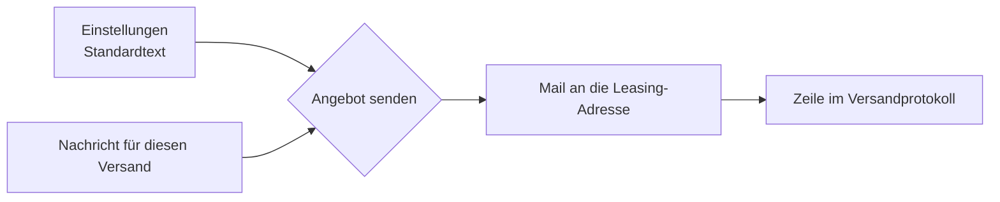
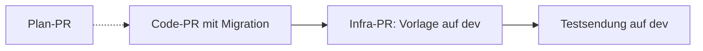

# Titel des Strangs — Bericht

<!-- Vorlage (docs/plan-leitstand.md, Teil C, C.7) — diesen Kommentar im echten Bericht löschen (er erscheint sonst als Text). Der Kopf oben ist Pflicht, ist die Exec Summary und muss zum Text passen:
     titel: ein Satz, was jetzt geht. worum: 2–3 Sätze für jemanden, der den Chat nicht kennt. anders: höchstens 4 Punkte.
     offen: was Knut tun muss. github: je Repo/PR eine Zeile mit was (Inhalt); pr: nur, wenn es den PR auf GitHub gibt — sonst
     weglassen, dann steht „lokal, nicht auf GitHub“. Den Stand (offen/gemergt) holt der Leitstand selbst von GitHub.
     status: bereit_fuer_github nur, wenn Tests grün, Review-Pässe durch und nichts offen; wartet_auf_knut, wenn Knut etwas
     ansehen oder entscheiden soll; blockiert, wenn es ohne Hilfe nicht weitergeht. offen höchstens 5 Zeilen.
     review: Coder-Vorschau mit Login-Link (die Werkbank prüft, ob sie antwortet), Screenshots (relativ im Paket), PR-Text.
     fragen: nur echte Entscheidungen, je mit Empfehlung; antwort bleibt leer, bis Knut antwortet (kommt als „Nacharbeit nach Review“).
     alternativen (je Frage, optional): 2–3 kurze, konkrete Alternativen zur Empfehlung, wenn es echte gibt — Knut klickt sie an
     statt zu tippen (Antwort „Anders: <Alternative>“). Inline ["a", "b"] oder als Block-Liste.
     github: je Repo Zweig und der Commit, den Knut freigeben soll (≥ 7 Zeichen). Neuer Commit → Kopf ändern; Knuts Freigabe gilt
     nur für genau diesen Stand. -->

**Stand:** TT.MM.JJJJ · **Repo:** … · **Branch:** `…` (lokal, nicht gepusht) · **Plan:** …

## Wie es jetzt funktioniert

## Ausroll-Reihenfolge

<!-- nur bei mehreren PRs oder Repos -->

## Was gebaut ist

- …

## So sieht es aus

## Geprüft

| # | Punkt | Stand |
|---|---|---|
| 1 | Typecheck, Lint | ja |
| 2 | Tests | ja |
| 3 | GitHub-CI | nein |

## Entscheidungen

**D1 — Ansprechperson ohne Bearbeiter**
Kontext in zwei bis vier Sätzen. Optionen mit Folge. Empfehlung: die erste Zuständige.
- Knut:
