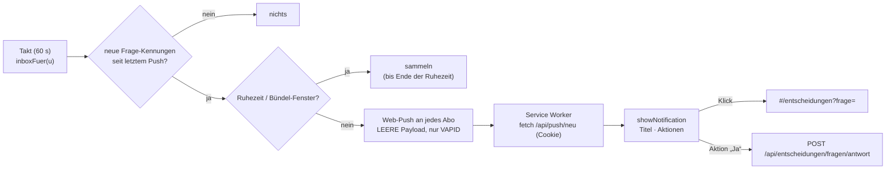

# Web-Push: „Ein Strang fragt“ als Chrome-Benachrichtigung

## Ziel

Fragt ein Unter-Chat (oder der Hauptchat) Knut etwas, zeigt Chrome sofort eine Benachrichtigung — auch wenn der Workspace
nicht offen ist. Ein Klick öffnet genau diese Frage auf der Entscheidungsseite; einfache Fragen lassen sich direkt aus der
Benachrichtigung beantworten. Nichts Inhaltliches geht dabei über fremde Server.

## Stand heute (Basis `release/werkbank-2026-10-20a`)

- **Eine Quelle für „wartet auf dich“:** die Inbox (`web/server/inbox.ts`, `baueInbox`) sammelt Rückfragen (`orch ask`),
  Bericht-Entscheidungen (D1 … aus dem Kopf und dem Text), „Braucht Knut“ und Push-Freigaben; `fragenAus`
  (`web/server/entscheidungsseite.ts`) macht daraus die Karten der Entscheidungsseite (`#/entscheidungen`). Jede Karte hat eine
  feste Kennung (`kennung.entscheidung(strang, berichtHash)` bzw. `<Kennung>~D1`).
- **Antworten an der Quelle:** `POST /api/entscheidungen/fragen/antwort` (`web/server/main.ts`) mit `ja | nein | anders | spaeter`
  — dieselbe Route nutzt die Seite; „Anders: <Alternative>“ seit Paket 266 mit einem Klick.
- **Kein Service Worker, kein Manifest, keine Benachrichtigung** im Web (`web/public/` hat nur `favicon.svg`). Die Seiten laufen
  mit `base: './'` auch unter dem LibreChat-Proxy `/werkbank/` (`web/vite.config.ts`).
- **Erreichbar nur über HTTPS** (Coder-Subdomain bzw. LibreChat-Proxy) — Voraussetzung für Service Worker und Push erfüllt.
- **Der Status-Takt** (`startStatusTick`, `web/server/orchestrator.ts`) setzt regelmäßig den Zustand je Unter-Chat (`wartet`,
  `fertig` …); die Inbox wird pro Anfrage neu gebaut (`inboxFuer`, `web/server/main.ts`).

## Ansatz

1. **Abo** (Einrichtung › Benachrichtigungen): Knopf „Benachrichtigungen einschalten“ → `Notification.requestPermission()` nur
   auf Klick, `serviceWorker.register('./sw.js')`, `pushManager.subscribe({ userVisibleOnly: true, applicationServerKey })`.
   Das Abo (Endpoint + Schlüssel) geht an `POST /api/push/abo` und liegt je Person in `push_abos` (Mongo); „Ausschalten“ löscht es.
   Antwortet der Push-Dienst 404/410, wird das Abo automatisch gelöscht.
2. **VAPID** ohne neue Abhängigkeit: ES256-Schlüsselpaar einmalig erzeugt (`node:crypto`), privat in der `.env.local` der Instanz
   (`WERKBANK_VAPID_PRIVATE`), öffentlich über `GET /api/push/schluessel`. Das JWT (`aud` = Origin des Endpoints, `exp` ≤ 12 h,
   `sub` = mailto der Instanz) signiert der Server selbst.
3. **Leere Payload („Tickle“):** der Push trägt keinen Inhalt — damit entfällt die Payload-Verschlüsselung (RFC 8291), und beim
   Push-Dienst (Google FCM) liegt nur „wecke dieses Gerät“. Der Service Worker holt beim Aufwachen mit dem Sitzungs-Cookie
   `GET /api/push/neu`: höchstens drei Kurzzeilen (Titel ≤ 80 Zeichen, Kennung, ob „Ja“ direkt erlaubt ist). Ohne gültige
   Sitzung zeigt er nur „Im Workspace wartet etwas auf dich“.
4. **Auslöser = neue Frage-Kennungen der Inbox:** ein Takt (60 s, nur für Personen mit Abo) baut `fragenAus(inboxFuer(u))` und
   vergleicht die Kennungen mit den schon gemeldeten (`push_gemeldet`, je Person, 14 Tage). Damit lösen Rückfragen, Bericht-
   Entscheidungen, „Braucht Knut“ und Push-Freigaben gleich aus — keine zweite Logik neben der Inbox.
5. **Klick öffnet die Frage:** `notificationclick` → vorhandenes Workspace-Fenster fokussieren oder `clients.openWindow`
   auf `#/entscheidungen?frage=<Kennung>`; die Seite scrollt zur Karte und hebt sie hervor (neu: Query-Parameter `frage`).
6. **Antworten aus der Benachrichtigung** (Notification-Actions): Chrome auf Desktop und Android zeigt höchstens zwei Aktionen
   (`Notification.maxActions`). Vorschlag: „Ja (wie empfohlen)“ und „Öffnen“ — „Ja“ nur bei Stufe *normal* mit Empfehlung und
   nur bei Art Rückfrage/Entscheidung (nie Push-Freigabe, nie Vault). Die Aktion ruft dieselbe Antwort-Route; danach eine
   stille Bestätigung („Gespeichert“) oder bei 409 „Hat sich geändert — öffnen“. Alternativen als Aktionen: siehe W2.
7. **Ruhezeiten und Bündelung:** in der Ruhezeit nichts senden, sondern sammeln; am Ende eine Benachrichtigung „3 Fragen
   warten“. Außerhalb höchstens eine Benachrichtigung je 10 Minuten; mehrere neue Fragen in einem Fenster = eine Sammel-
   Benachrichtigung (gleicher `tag`, `renotify`), Klick öffnet dann die Entscheidungsseite ohne Sprung.
8. **Nichts Geheimes:** Payload leer; `/api/push/neu` liefert nur Titel und Kennung (keine Kontexte, keine Pfade, keine
   Kundendaten); der VAPID-Schlüssel steht nur in der `.env.local` (Zeiger, nie im Repo/Log); Push-Endpoints werden nicht geloggt.

## Was geprüft werden muss, bevor gebaut wird

- **Origin des Service Workers:** wo Knut den Workspace öffnet (Coder-Subdomain direkt oder LibreChat unter `/werkbank/`). Der
  Worker gilt nur für seinen Pfad; Abo und Klick-Ziel müssen auf demselben Origin liegen (W1).
- **Coder-Anmeldung im Service Worker:** ob `fetch('/api/push/neu', { credentials: 'include' })` aus dem Worker durch die Coder-
  Anmeldung kommt (Cookie der Subdomain) — sonst bleibt nur die generische Zeile.
- **Actions auf dem Gerät:** Chrome Desktop (Linux/Mac/Windows) und Chrome Android zeigen Aktionen; macOS-Systembenachrichtigungen
  zeigen sie erst über „Optionen“. iOS/Safari nur als installierte Web-App (ab iOS 16.4), ohne Aktionen — außerhalb des Umfangs.
- **Ausgehender Zugriff der VM** auf `fcm.googleapis.com` (Port 443) — sonst kommt kein Push an.

## Umfang

- **In:** Abo an/aus in der Einrichtung, Service Worker (`web/public/sw.js`), VAPID-Signatur mit `node:crypto`, Takt mit
  Kennungs-Abgleich, `/api/push/{schluessel,abo,neu}`, Sprung `#/entscheidungen?frage=`, Aktion „Ja (wie empfohlen)“, Ruhezeiten,
  Bündelung, Tests (JWT, Abgleich, Ruhezeit/Bündel rein; Route mit Nachbau-Push-Dienst), Sichtprüfung mit Bildern.
- **Out:** iOS, E-Mail/Slack als zweiter Kanal, Push für andere Ereignisse (PR-Review fertig, Push-Freigabe erledigt), Inhalte in
  der Payload, Team-Personen außer Knut (später derselbe Weg je Person).

## Entscheidungen

**W1 — Wo lebt der Service Worker?**
Optionen: (a) unter dem LibreChat-Proxy `/werkbank/` (da, wo Knut den Workspace öffnet) · (b) auf der Coder-Subdomain der Web-App
direkt · (c) beide, je eigenes Abo.
Empfehlung: (a), weil Knut den Workspace dort offen hat und Klicks im selben Fenster landen; (b) nur, falls der Proxy den Worker
nicht ausliefern darf.
  - Knut:

**W2 — Antworten direkt aus der Benachrichtigung: wie weit?**
Optionen: (a) nur „Öffnen“ · (b) „Ja (wie empfohlen)“ + „Öffnen“ bei Stufe normal · (c) zusätzlich die erste Alternative als
zweite Aktion (statt „Öffnen“; der Klick auf die Benachrichtigung öffnet trotzdem).
Empfehlung: (b) — eine Aktion, die man ohne Kontext guten Gewissens tippt; Alternativen brauchen meist den Kontext der Karte.
  - Knut:

**W3 — Ruhezeiten**
Optionen: (a) keine · (b) werktags 20:00–07:30 und am Wochenende stumm, gesammelt um 07:30 · (c) frei einstellbar in der Einrichtung.
Empfehlung: (b) als Vorgabe, (c) später, wenn jemand anderes es nutzt; „wichtig + hält einen Unter-Chat an“ geht nur bei (c)
mit Ausnahme durch.
  - Knut:

**W4 — Bündelung**
Optionen: (a) jede Frage einzeln · (b) höchstens eine Benachrichtigung je 10 Minuten, mehrere als Sammelzeile · (c) je Strang
eine (gleicher `tag`, neue Frage ersetzt die alte).
Empfehlung: (b) — mehrere Stränge melden sich oft gleichzeitig, einzelne Pings je Frage wären laut.
  - Knut:

**W5 — Was steht auf dem Sperrbildschirm?**
Optionen: (a) nur „Im Workspace wartet etwas auf dich“ · (b) Kurztitel der Frage (≤ 80 Zeichen) und der Strang.
Empfehlung: (b) — Fragen enthalten nach der Vault-Regel keine Kundendaten, der Titel macht die Benachrichtigung erst nützlich;
der Inhalt kommt trotzdem nie über die Payload, sondern aus der eigenen Sitzung.
  - Knut:

**W6 — Welche Geräte?**
Optionen: (a) Chrome am Rechner · (b) zusätzlich Chrome auf dem Android-Handy · (c) zusätzlich iPhone als installierte Web-App.
Empfehlung: (a)+(b) — gleicher Code; (c) braucht Manifest und Installation und kann keine Aktionen, also eigener Schritt.
  - Knut:

## Ausrollen

Ein PR im Werkbank-Repo; VAPID-Schlüssel einmalig je Instanz erzeugen (`scripts/werkbank.sh vapid`, schreibt nur die eine Zeile
in `.env.local`). Ohne Schlüssel bleibt alles aus (Knopf in der Einrichtung grau mit Hinweis). Kein Umbau bestehender Routen.

## Definition of Done

Wörtlich (Knut, 20.10.2026): „chrome push nachrichten aktivieren die mich dann im workspace auf sowas wie die entscheidungsseite
bringen und ich direkt wenn ein strang fragt antworten kann“. Prüfbar heißt das:

1. In der Einrichtung schaltet ein Klick Benachrichtigungen ein; Chrome fragt erst dann nach der Erlaubnis; „Ausschalten“ löscht
   das Abo auf Server und Gerät.
2. Stellt ein Unter-Chat eine Rückfrage oder schreibt eine D-Frage in seinen Bericht, kommt innerhalb von 2 Minuten eine
   Chrome-Benachrichtigung — auch bei geschlossenem Workspace-Tab (Chrome läuft).
3. Ein Klick darauf öffnet die Entscheidungsseite mit genau dieser Frage im Blick.
4. „Ja (wie empfohlen)“ aus der Benachrichtigung trägt die Antwort an der Quelle ein (wie der Knopf auf der Seite); der
   Unter-Chat macht weiter. Bei wichtigen Fragen gibt es die Aktion nicht.
5. In der Ruhezeit kommt nichts; danach eine Sammel-Benachrichtigung. Mehrere Fragen binnen 10 Minuten = eine Benachrichtigung.
6. Die Push-Payload ist leer (Test mit Nachbau-Push-Dienst prüft die Länge 0); `/api/push/neu` gibt ohne Sitzung nichts heraus;
   kein Endpoint und kein Schlüssel im Log.
7. Tests des Repos und Build grün; Bilder der Einrichtung und einer Benachrichtigung (Desktop + Android) im Review-Paket.
