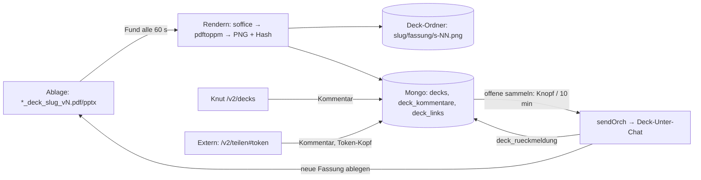

# Deck-Review in der Werkbank 2.0

Stand 07.11.2026 · Auftrag Knut („dont be lazy lets get the deck review module … in“) · Zweig `feat/v2-deck-review` (Basis `feat/werkbank-2` @ `83fe1c1`). Jira: keins (Werkbank-intern).

## Ausgangslage

Heute laufen drei kopierte Nebenserver (Zwischengate, Flex-Vortrag, Wirtschaftlichkeit) je mit `server.py` (Folienbilder, Kommentar je Folie, `kommentare.json`, `stand.json`), `render.sh` (neuestes PDF → PNG, Änderungs-Hash je Folie) und `weiterleiter.sh` (alle 20 s neue Kommentare per `orch send` an den Deck-Unter-Chat, nach neuer Fassung „erledigt“). Probleme: Ports gehen beim Neustart verloren, jede Instanz ist eine Kopie mit fest eingetragenem Strang und Dateimuster, externe Kommentatoren (Peter) haben keinen eigenen Zugang, der Status „erledigt“ wird geraten (neue Fassung = umgesetzt), es gibt kein „abgelehnt mit Grund“.

## Soll

1. **Seite `v2/decks`**: Liste der Decks aus der Ablage (Dateinamen `JJJJ-MM-TT_deck_<slug>_v<fassung>.pdf|pptx` in Dokumente, Review-Paketen und dem Teilen-Ordner), je Deck die Fassungen v1…vn. Angelegte Decks zeigen Folienbilder, Kommentar je Folie (Text, optional Markierung als Rechteck auf der Folie), Status je Kommentar (offen · an Unter-Chat · umgesetzt · abgelehnt mit Grund · Notiz), Vergleich zweier Fassungen je Folie.
2. **Teil-Link für Externe**: je Deck ein Link mit eigenem Token — nur dieses Deck, nur lesen und kommentieren, ablaufend, widerrufbar; Name beim ersten Kommentar; keine Werkbank-Anmeldung.
3. **Verbindung zum Deck-Unter-Chat**: offene Kommentare gesammelt senden (Knopf + automatisch alle 10 min, je Deck abschaltbar) über denselben Weg wie `orch send`; der Unter-Chat meldet je Kommentar zurück (Werkzeug `deck_rueckmeldung` → umgesetzt/abgelehnt mit Grund); eine neue Datei in der Ablage (oder „Neu rendern“) erzeugt eine neue Fassung (pptx → pdf → png).
4. **Migration** der drei bestehenden Decks samt Kommentaren und gerenderten Fassungen (Skript, Trockenlauf zuerst).

## Architektur

- `web/server/decks.ts` — reine Logik ohne I/O-Nebenwirkung: Dateinamen lesen und gruppieren, Fassungen sortieren, Statusregeln, Nachricht an den Unter-Chat, Token-Prüfung (nur Hash gespeichert), Rate-Limit, sichere Pfade, Hash aus PGM.
- `web/server/deckroutes.ts` — Routen, Datenbank, Render-Schlange (ein Lauf zur Zeit, `execFile` ohne Shell, Zeitlimit), Takt (Fund + automatisches Senden).
- `web/app/src/decks.tsx` — Liste, Deck-Ansicht, Vergleich, Teil-Links, öffentliche Teilen-Seite.
- `web/mcp/werkbank-tools.ts` — Werkzeug `deck_rueckmeldung` (nur für den verknüpften Unter-Chat oder die Besitzerin).
- `web/scripts`-frei: Import als `web/server/deck-import.ts` (CLI, `--trocken` Vorgabe, `--schreiben` zum Übernehmen).

## Sicherheit

- Alle `/api/v2/decks*`-Routen hinter `needUser`; Anlegen, Senden, Status, Einstellungen, Links, Rendern nur Admin.
- Öffentlich nur `/api/deck-teilen/*`: Token im Kopf `x-deck-token` (nie in der Adresse der Seite — dort nur als `#…`), 32 Byte Zufall, in der Datenbank nur SHA-256; Ablauf (Vorgabe 14 Tage, höchstens 90), Widerruf; Zugriff nur auf das eine Deck; nur lesen + kommentieren; POST braucht `x-werkbank: 1`.
- Rate-Limit: je Link 30 Kommentare je 10 min, je Adresse 60 Fehlversuche je 10 min; Text ≤ 4 000, Name ≤ 40 Zeichen.
- Folienbilder: Fassung und Foliennummer per Muster (`^[\w.-]{1,40}$`, Zahl 1–999), Pfad wird gebaut und mit `resolve` gegen den Deck-Ordner geprüft; nie ein Pfad aus der Anfrage.
- Rendern: `execFile` mit festen Argumenten, Quelle nur aus dem Fund (Ablage-Wurzeln), Zeitlimit 120 s.

## Nicht in diesem Schritt

Live-Wechsel, Push, Abschalten der alten Nebenserver (erst nach Knuts Go), Freigabe des Ports für Externe (Betrieb).

## Schnitte

1. Logik + Tests (rot → grün): Dateinamen, Status, Token, Rate-Limit, Pfade, Nachricht.
2. Routen + DB + Rendern + Takt, Tests gegen Test-Mongo.
3. Oberfläche (v2-Look, 1440/390), öffentliche Seite.
4. Werkzeug `deck_rueckmeldung`.
5. Import-Skript mit Trockenlauf, Tests.
6. Aktiver Test mit Beispiel-Deck auf eigener Testkopie, Screenshots, Pass A/B/C.
