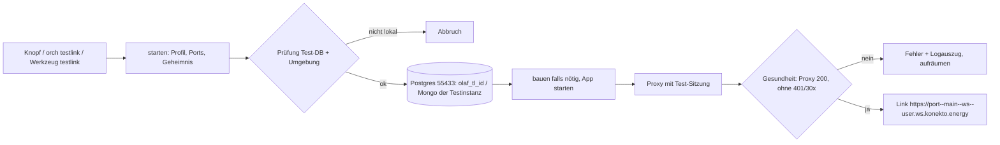

# Plan: angemeldete Test-Links (Werkbank 2.0)

Auftrag (Knut, 06./07.11.2026): „remember to give me a magic logged in link always — this is a test env“ und „dont be lazy … signed in links also in“. Bisher wurde das fünfmal von Hand gebaut (ein Skript, das Superadmin und Sitzung in eine Test-Datenbank schreibt, zwei Cookie-Proxys, ein Startskript je Vorschau). Jetzt wird es eine Funktion der Werkbank: je Worktree oder Unter-Chat eine **Test-Umgebung** mit einem fertigen, angemeldeten Link.

## Was gebaut wird

| # | Teil | Wo |
|---|---|---|
| 1 | Profil erkennen: `olaf-admin`, `olaf-tariff-app`, `werkbank` (v2-Testkopie), `statisch` | `web/server/testlink.ts` (`profilVon`) |
| 2 | Freie Ports aus einem Bereich (`WERKBANK_TESTLINK_PORTE`, Vorgabe 3600–3699), Prozesse mit PID und Startzeit, Stoppen nur verifizierter PIDs (Prozessgruppe), nie `pkill -f` | `testlink.ts` |
| 3 | Test-DB: lokale Postgres 127.0.0.1:55433, eigene DB `olaf_tl_<id>` je Umgebung, Migrationen, Seed; Werkbank: eigene Mongo der isolierten Instanz (`scripts/isoliert.sh`) | `testlink.ts` |
| 4 | Harte Prüfung: DB-Host lokal, Port 55433, DB-Name `olaf_tl_…`; jede Umgebungsvariable mit Prod/UAT/Azure-Adresse wird geleert (nie übernommen), DB-Werte werden immer überschrieben | `testDbPruefen`, `envPruefen` |
| 5 | Mails im Trockenlauf (`MAIL_DRY_RUN=true`, `BREVO_API_KEY` leer), Tarif-App mit `NEXT_PUBLIC_ADMIN_DEV_BYPASS=true` und ohne Rechen-API, Werkbank mit `WERKBANK_DRYRUN=1` und Brücke im Mock | Profile in `testlink.ts` |
| 6 | Sitzungs-Geheimnis je Umgebung (zufällig, Datei mit Rechten 600, nie in API/Log), Sitzung und Link laufen nach 7 Tagen ab; Aufräumen alle 10 min | `testlink.ts`, `main.ts` |
| 7 | Angemeldeter Proxy (Node, streamt, auch SSE/WebSocket): hängt die Test-Sitzung an, nimmt nur Anfragen über die Coder-Vorschau (`*.ws.konekto.energy`) oder lokal an, antwortet nach Ablauf mit 410 | `web/server/testlink-proxy.ts` |
| 8 | Gesundheitscheck nach Start: mit Proxy 200, direkt ohne Sitzung 401/30x (bei Profilen mit Anmeldung); sonst Fehler mit Logauszug (Geheimnisse geschwärzt) und Aufräumen | `gesundheit` |
| 9 | 2.0: Knopf „Test-Link“ auf der Unter-Chat-Seite, Seite „Test-Umgebungen“ (unter Mehr) mit Liste (Link, Stand/Commit, Ablauf, Stoppen) und Start für einen beliebigen Worktree | `web/app/src/testlinks.tsx`, `unterchat.tsx`, `App.tsx`, `seiten.tsx` |
| 10 | CLI `orch testlink [<strang\|ordner>] [--stop] [--neu] [--json]`; Strang-Werkzeug `testlink`; der Strang-Auftrag verlangt den angemeldeten Link im Bericht (`review:`) | `orch-cli.ts`, `main.ts`, `mcp/werkbank-tools.ts`, `orchestrator.ts` |

## Ablauf

## Sicherheit

- Nur Test-Datenbanken: Host `127.0.0.1`/`localhost`, Postgres-Port 55433, DB-Name `olaf_tl_<id>`; sonst kein Start.
- Keine Prod/UAT-Adresse gelangt in die Umgebung: solche Werte aus `.env*` werden geleert (Next übernimmt eine vorhandene, auch leere Variable nicht aus der Datei).
- Link nur über die Coder-Vorschau (mit Coder-Anmeldung): Proxy lauscht nur auf 127.0.0.1 und prüft den Host.
- Ablauf nach 7 Tagen: Sitzung in der DB, Proxy (410) und Aufräumen (Prozesse, DB, Geheimnis).

## Nicht in diesem Schritt

- Kein Live-Wechsel; die Live-Werkbank bekommt die Funktion erst mit dem nächsten Release.
- Port-Freigabe „public“ in Coder lässt sich von hier nicht prüfen — die Vorgabe (nur Besitzer) gilt.

## Tests

`web/test/testlink.test.ts` (Profile, Prüfungen, Ports, Cookie-Signatur, Proxy, Lebenszyklus mit Attrappen, Routen ohne Geheimnisse). Aktiv: Bot-Zweig des olaf-admin und v2-Testkopie aus diesem Worktree, Screenshots.
