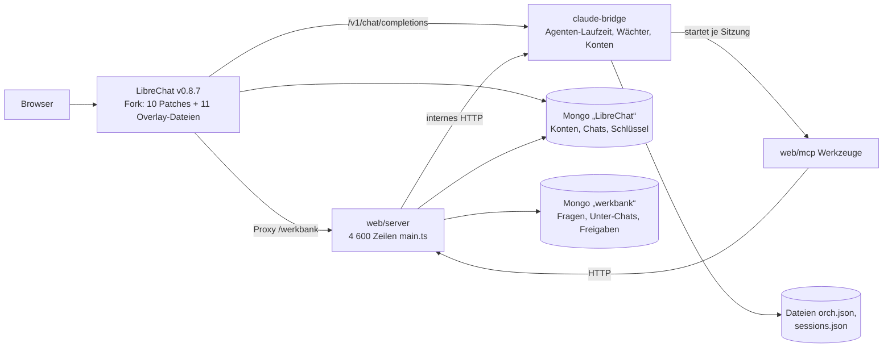
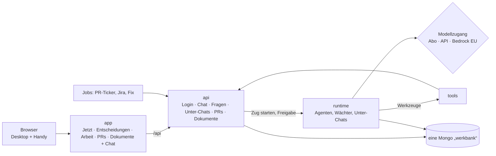

# Werkbank 2.0 — eine App statt vieler Orte

Stand 03.11.2026 · Grundlage: Abnahme R31 (20 echte Anfragen vom 02.11.), Persona-Test Paket 428 (Runde 1: Knut 0 von 6 Aufgaben ohne Reibung, Lisa 0 von 6), UX-Test Paket 422, Vergleich Paket 430, R33 Paket 427.

## 1. Wofür es die Werkbank gibt

Knut gibt Arbeit an Agenten ab und entscheidet, was sie nicht selbst entscheiden dürfen. Die Werkbank muss ihm in jedem Moment drei Dinge sagen: **was jetzt von mir gebraucht wird**, **was gerade läuft** und **was fertig ist** — und ihm erlauben, im selben Bild zu antworten oder nachzufragen. Alles andere (Board, Sprint, Ziele, Skills, Einrichtung, Betrieb) ist Werkzeug für Ausnahmen, nicht Startseite.

## 2. Knuts Kern-Workflows

| # | Workflow | Heute (Paket 428) | In 2.0 |
|---|---|---|---|
| W1 | **Was ist offen, wo fange ich an?** (mehrmals täglich) | drei verschiedene Zahlen auf einem Bildschirm, „Fang hier an“ = fünf gleiche Push-Karten | Startseite: oben „Was du jetzt tun musst“, höchstens 5, wichtigste zuerst, **eine** Zahl |
| W2 | **Entscheiden** — Empfehlung übernehmen oder eigenen Text schicken | Massen-Knopf im Daumenbereich, Antwort landet an der falschen Karte | jede Entscheidung als Karte: Empfehlung · „Ja, so“ · „Anders: …“; Karte bleibt stehen und zeigt „✓ ging an …“ |
| W3 | **Nachfragen** — „Was ist das?“, „was meinst du damit?“ | Hauptchat ist eine eigene Welt, „Was ist das?“ wartet stumm | „Was ist das?“ erklärt sofort aus den Daten; „Im Chat fragen“ öffnet den Hauptchat als Seitenleiste mit vorbereiteter Frage |
| W4 | **Was ist heute fertig geworden?** | „fertig“ mischt „wartet auf dein Review“, Uhrzeit = Ladezeit | „Heute erledigt“ nur Fertiges, mit echter Uhrzeit und Link auf Bericht/Dokument |
| W5 | **Wie steht Unter-Chat X, muss ich etwas tun?** | rohes Markdown, „D4 beantworten“ ohne D4 | Arbeit-Ansicht: Zustand in einem Satz, offene Frage direkt an der Karte |
| W6 | **Welche PRs brauchen mich (oder Person X)?** | 38 PRs, selbst nach Namen suchen | PR-Liste „wartet auf: ich ▾“, Vorgabe = ich, umschaltbar auf jede Person |

Dazu für das Team: **Lisa** (neu) findet sich ohne Fachwörter zurecht und findet Dokumente; **Christoph** (Reviewer) sieht ohne eigenes Claude-Abo, was auf ihn wartet. Unterwegs (nur Handy): die wichtigste Entscheidung in unter 30 Sekunden.

## 3. Informationsarchitektur

**Eine Startseite („Jetzt“).** Nach dem Login landet man immer hier, nie im leeren Chat.
1. **Was du jetzt tun musst** (≤ 5, die Zahl daneben ist die einzige Zahl der Seite) — Entscheidungen mit Empfehlung, sortiert nach „hält Arbeit an“ und „wichtig“, höchstens zwei Freigaben darunter.
2. **Läuft gerade** — Unter-Chats mit Satz „woran“ und voraussichtlichem Ende.
3. **Heute erledigt** — nur Fertiges, je mit Link.
4. **PRs, die auf dich warten.**
5. **Neue Dokumente** — Berichte und Dateien, immer als Link.

**Links nur fünf Bereiche:** Jetzt · Entscheidungen · Arbeit · PRs · Dokumente. **Der Chat** ist kein Bereich, sondern eine Seitenleiste auf jeder Seite (am Handy: Knopf unten rechts, öffnet von unten). Oben rechts „?“ = Begriffe in Klartext.

**Jede Karte** hat dieselben Teile: Titel in Klartext · ein Satz „worum“ · Links (Bericht, Dokument, PR) · „Was ist das?“.

**Fällt weg (in 2.0, die alte Werkbank behält es):** Leitstand, Morgenlage, Tageskarte, Lage, Übersicht, Fang-hier-an als eigene Seite, Timebox, Ablage-Ansicht, Massen-Antwort-Knopf, Kontingent auf der Startseite. Board, Sprint, Ziele, Wissen, Skills, Einrichtung bleiben in der alten Werkbank erreichbar (Link „Alte Werkbank“ im Menü).

## 4. Begriffe (in der Oberfläche nur diese)

| Wort in 2.0 | Bedeutet | ersetzt |
|---|---|---|
| **Chat** (bei Knut: **Hauptchat**) | dein Gespräch mit dem Assistenten, der die Arbeit verteilt | Leitstand, Orchestrator, Koordinator |
| **Unter-Chat** | ein Auftrag, an dem ein Agent selbstständig arbeitet | Strang, Lauf, Session |
| **Wartet auf dich** | etwas, das ohne deine Antwort nicht weitergeht | Braucht dich, Braucht Knut, Inbox |
| **Entscheidung** | Frage mit Empfehlung; „Ja, so“ oder „Anders: …“ | D1, Rückfrage, Freigabe-Karte |
| **Freigabe** | Erlaubnis für einen Schritt nach außen (z. B. Push auf GitHub) | Push freigeben, Gate |
| **Dokument** | alles Lesbare: Bericht, Notiz, Datei | Vault-Notiz, Review-Paket, Ablage |

## 5. Architektur

### 5.1 Ist-Bild

| Kopplung | Was hängt dran | Fehlerquelle der letzten Wochen |
|---|---|---|
| **LibreChat als Hülle** | Login, Chatverlauf, Streaming, Seitenleiste; die Werkbank-Oberfläche wird als `/werkbank` durchgereicht, Antwortknöpfe und Chat-Kopf sind Patches im LibreChat-Client | jede Oberflächenänderung am Chat = Patch + Client-Neubau (1–2 min) + Neustart; 12 von 47 Commits seit 06.10. betreffen `librechat/`; Hauptchat lud 20 s (Desktop) bzw. 2 min (Handy), R33 musste das im fremden Client umbauen |
| **Zwei Datenbanken** | web/server liest LibreChats Mongo direkt (`users`, `sessions`, `messages`, `conversations`, `keys`) und schreibt Claude-Token in LibreChats `keys` | Schema-Abhängigkeit von einer fremden App; Zahlen aus zwei Quellen laufen auseinander (W1 in 428) |
| **Zustand in Dateien** | Brücke hält Unter-Chats und Sitzungen in `orch.json`/`sessions.json`, web/server spiegelt Unter-Chats in Mongo | zwei Wahrheiten über „läuft/fertig“; R32 musste „Strangzustand = Wahrheit der Brücke“ nachziehen |
| **Ein großer Server** | `web/server/main.ts` 4 600 Zeilen: Routen für Oberfläche, Ticker, Jira, Fix-Pushes, Betrieb, Chief of Staff | ein Fehler in einem Teil = Neustart des Ganzen; Release mit Drain, weil Neustarts laufende Unter-Chats abbrachen (31× in 14 Tagen, Plan 213) |
| **Schalter** | rund 135 verschiedene `BRIDGE_*`/`WERKBANK_*`-Variablen; Doppelungen (`WERKBANK_URL`/`WERKBANK_BRIDGE_URL`/`BRIDGE_URL`, drei Arten Trockenlauf) | Verhalten hängt am Schalterstand; Test-Instanzen brauchen eine eigene Sperrliste von 40 Zeilen |

### 5.2 Fragen und Antworten

**Brauchen wir LibreChat noch?** Nein, auf Sicht nicht. Was wir von LibreChat wirklich nutzen, sind Login, Chatverlauf und das Streaming-Fenster. Die Agenten-Laufzeit, die Wächter, die Freigaben und alle Ansichten sind schon unsere. Der Chat-Endpunkt der Brücke ist OpenAI-kompatibel, web/server ruft ihn bereits selbst auf („Agent ansetzen“). Ein eigener Chat-Teil ist also klein: Nachricht speichern, Zug auf der Brücke starten, Antwort mitschreiben, Browser liest mit. Was wir verlieren: Teilen-Links, Volltextsuche im Chatverlauf, Datei-Upload im Chat, LibreChats Agenten-Marktplatz — nichts davon steht in Knuts Workflows; Upload und Suche kommen als eigene, kleine Teile, wenn sie gebraucht werden.

**Ein Repo oder mehrere?** Ein Repo mit klaren Paketen (npm-Workspaces), nicht getrennte Repos. Begründung: ein Hauptentwickler, Änderungen gehen fast immer über Laufzeit + API + Oberfläche gleichzeitig; getrennte Repos machen jede solche Änderung zu drei PRs mit Versionsabgleich. Die Grenzen sichern Paketgrenzen mit eigenen Tests und eine Importregel („app importiert nie aus api“), nicht Repo-Grenzen.

| Paket | Inhalt | Grenze |
|---|---|---|
| `runtime` (heute `claude-bridge`) | Agenten-Laufzeit, Wächter, Konten, Unter-Chats, **Modellzugang** | spricht nur HTTP nach außen; keine Oberfläche |
| `api` (heute `web/server`) | eine HTTP-API: Login, Chat, Fragen, Unter-Chats, PRs, Dokumente; Hintergrundjobs (Ticker, Jira, Fix) als eigene Module | einzige Stelle mit Datenbankzugriff |
| `app` (neu, heute `web/app`) | die 2.0-Oberfläche inkl. Chat | nur über `api`, nie direkt Brücke oder DB |
| `tools` (heute `web/mcp`) | Werkzeuge der Agenten | nur über `api` |
| `shared` | Typen der API, Begriffe, Schalter-Schema | ohne Laufzeit-Abhängigkeiten |

**Ein Deploy-Weg.** `npm run build` (alle Pakete) → ein Neustart mit Drain. Kein Patch, kein Client-Neubau. Die App ist eine statische Datei-Ablage, die die API ausliefert; Oberflächenänderungen brauchen gar keinen Neustart der Laufzeit.

**Konfiguration.** Ein Schalter-Schema in `shared` mit drei Klassen: *Betrieb* (Ports, Pfade — Pflicht, ohne Vorgabe), *Sicherheit* (Sperren wie Push/Jira-Schreiben — Vorgabe „aus“, nur bewusst an), *Funktion* (neue Funktionen — jeder Schalter mit Ablaufdatum; nach zwei Wochen „an“ wird er gelöscht und die Funktion ist Standard). Start bricht ab, wenn ein unbekannter Schalter gesetzt ist.

**Daten.** Eine Datenbank `werkbank` als einzige Quelle für Personen, Chats, Nachrichten, Fragen und Unter-Chats; `orch.json`/`sessions.json` wandern in Collections (die Brücke schreibt, die API liest). Während des Umstiegs liest die API LibreChats Verlauf nur noch lesend.

**Team-Fähigkeit.** Eine Instanz für alle, nicht je Person eine. Lesen geht ohne Claude-Zugang (Lisa, Christoph); der Chat braucht einen Modellzugang. Rechte: *lesen* (Team) · *entscheiden* (wem die Frage gehört) · *Hauptchat* (Knut).

**Abo-Token-Risiko (Paket 430).** Die Laufzeit bekommt eine Schnittstelle „Modellzugang“ mit drei Möglichkeiten: Abo-Anmeldung (heute), API-Schlüssel, Bedrock/Vertex in der EU-Region. Welcher Weg gilt, entscheidet Knut (430 D1); die Architektur hängt nicht mehr davon ab.

### 5.3 Zielbild

### 5.4 Migrationspfad (die alte Werkbank läuft durchgehend weiter)

| Schritt | Was | Woran man merkt, dass es geht |
|---|---|---|
| **0 — heute Nacht** | `web/app` (eigene Vite-App, Route `/v2`), `web/server/v2*.ts` (eine schmale API für die App: Start, Arbeit, PRs, Dokumente, **Chat**: neue Chats direkt auf der Brücke, der bestehende Hauptchat über LibreChats Serverweg — ein Schreiber je Unterhaltung, siehe 5.5), Begriffe und Rangregel als getestete Module. Nur auf einer Test-Instanz mit Datenkopie. | Persona-Test Runde 1/2 gegen die Messlatte aus 428 |
| 1 | `/v2` mit dem nächsten Release in die Live-Werkbank (ohne Schalter: neue Route stört nichts). Knut nutzt 2.0 und alt parallel. | Knut stellt „was ist offen?“ einen Tag lang nicht mehr |
| 2 | Hauptchat-Umstieg: der Hauptchat wird in 2.0 geführt (eigener Verlauf in `werkbank`), der LibreChat-Hauptchat wird schreibgeschützt. Unter-Chats starten als 2.0-Chats. | eine Woche ohne Wechsel in LibreChat |
| 3 | Eigenes Login (Konten aus LibreChat übernommen, Passwort-Hash bleibt gültig), npm-Workspaces und Paketumzug (`packages/runtime`, `api`, `app`, `tools`, `shared`), Schalter-Schema | `npm test` an der Wurzel prüft alle Pakete |
| 4 | `orch.json`/`sessions.json` in die Datenbank; Modellzugang als Schnittstelle | ein Zustand für „läuft/fertig“ |
| 5 | LibreChat abschalten (Verlauf bleibt lesbar exportiert), Patches und Overlay löschen | Deploy ohne Client-Neubau |

**Heute Nacht nicht:** Paketumzug und Workspaces (würde Live-Pfade und Skripte verschieben), eigenes Login (Login läuft weiter über das bestehende `/api/login`), Datenbank-Umzug der Brücke, Schalter-Aufräumen, Modellzugang. Begründung: Jeder dieser Schritte berührt Live-Betrieb; der 2.0-Stand soll schon im Zielbild liegen (eigene App, eigener Chat-Teil), ohne die alte Werkbank zu verändern.

### 5.5 Council zu Schritt 0 (03.11.2026)

Rollen: Befürworter, Fachprüfung, Advocatus Diaboli (zweites Modell: GLM 5.3 über Melious), Abschluss. **Urteil: HOLD — bauen, mit diesen Bedingungen** (Zuversicht 0,7; die Richtung trägt, aber der Chat ist der riskanteste Teil):

1. **Ein Schreiber je Unterhaltung.** Der bestehende Hauptchat und die Unter-Chats bleiben LibreChat-Unterhaltungen; 2.0 liest sie und schreibt in sie nur über LibreChats eigenen Serverweg (derselbe wie „Agent ansetzen“, `createLibreChat`). Neue 2.0-Chats laufen direkt auf der Brücke mit **eigener** Unterhaltungs-ID — nie eine LibreChat-ID wiederverwenden. Beides hinter einer Schnittstelle „Chatquelle“, damit Schritt 2 nur die Quelle tauscht.
2. **Züge laufen auf dem Server, nicht im Browser.** Die API startet den Zug, schreibt die Antwort fortlaufend in die Datenbank, der Browser liest nach (übersteht Netzwechsel am Handy). Ein Zug, der beim Neustart der API offen war, wird beim Start als „abgebrochen“ markiert und so angezeigt — nie stilles Hängen.
3. **Alle v2-Routen hinter der bestehenden Anmeldung** (`needUser`, Freigabeliste, `x-werkbank`-Kopf bei POST); Chat: höchstens ein laufender Zug je Person, Text ≤ 8 000 Zeichen; Hauptchat nur für Admin.
4. **Keine Freigabe nach außen in 2.0.** Push-/Jira-Karten erscheinen mit Link „in der alten Werkbank freigeben“; Antworten auf Fragen gehen über die bestehende Route `POST /api/entscheidungen/fragen/antwort` — mit Test.
5. **LibreChat-Zugriff nur in einem Modul** (Adapter); kein anderes v2-Modul liest LibreChats Datenbank.
6. **Importregel als Test:** `web/app` importiert nichts aus `web/server`, `claude-bridge` oder `web/src`.
7. **Handy wird gemessen**, nicht behauptet: Persona-Test auf 390 px ist Teil von Schritt 0.
8. **Kein Verschieben** von Verzeichnissen, Skripten oder Live-Pfaden heute Nacht.

Stärkster Einwand, sichtbar gelassen: Solange 2.0 LibreChat-Unterhaltungen liest, bleibt die Schema-Abhängigkeit bis Schritt 5 bestehen — der Adapter (Bedingung 5) begrenzt sie, beseitigt sie nicht.

## 6. Was 2.0 heute Nacht kann (und was nicht)

Kann: Startseite mit einer Zahl, Entscheidungen mit „Ja, so“ / „Anders: …“ über die bestehenden Antwortwege, „Was ist das?“ sofort, Arbeit (Unter-Chats) lesen, Heute erledigt, PRs „wartet auf …“, Dokumente mit Suche, Hauptchat als Seitenleiste, Lesen ohne Claude-Zugang. Nicht: Freigaben nach außen (Push, Jira) — der Knopf führt in den Chat bzw. die alte Werkbank, die Schreibwege bleiben die bestehenden der Brücke mit denselben Prüfungen; Board, Sprint, Einrichtung.

---

# Teil 2 — Vollausbau der 2.0 (Knut 03.11. abends, Paket 436 Runde 2)

**Quelle:** Knuts Feedback zur Test-Instanz (03.11. abends, 7 Punkte + Nachträge 1–4), Nutzungs-Audit Paket 437, Abnahme-Checkliste `nicht-verlieren.md` (Paket 436). **Jira:** keins (Werkbank-intern, Knut: keine Tickets ohne Auftrag).

## 7. Ziel und Abgrenzung

**Ziel:** Die 2.0 wird die Oberfläche, mit der Knut **und** das Team (Lisa neu, Christoph Reviews) ohne Erklärung arbeiten — und nichts aus der alten Werkbank geht stillschweigend verloren. „Jetzt“ (sortierte Top-Liste quer über alle Themen, sofort entscheiden) bleibt der Kern.

**Drin (Knuts Punkte):**
1. „Jetzt“ bleibt.
2. **Themen-Cluster** zurück: Entscheidungen, Unter-Chats, Dokumente und PRs lassen sich nach Thema gruppieren und filtern; „Jetzt“ bleibt quer über alle Themen.
3. **Alle Chats auffindbar:** alle Hauptchats (auch alte/beendete) und alle Unter-Chats (auch erledigt/archiviert), mit Suche, Thema, Datum, Status; von jeder Karte direkt in den zugehörigen Chat.
4. **Vollständigkeit:** Inventar aller Funktionen der alten Werkbank (web/, claude-bridge/, LibreChat-Patches, MCP) gegen die Abnahme-Checkliste; je Zeile „in V2“ / „in V2 über Mehr erreichbar (alte Seite)“ / „unverändert im Chat/Agenten (Beleg)“ / „bewusst gestrichen (Grund, Knut bestätigt)“ / „fehlt noch“. Nutzungs-Audit 437: kaum Genutztes wird sichtbar gehoben oder zum Streichen vorgeschlagen — nie still.
5. **Teammates:** eigene Startansicht je Rolle (Knut · Reviewer · neu im Team), Fachwörter ersetzt oder erklärt, Team-Freigaben respektiert.
6. **Offene Punkte aus Runde 1:** /v2 unter /werkbank/… lauffähig; eine Wortwahl für die Zahl („warten auf dich“, auch am Handy); D5 bereits entschiedene Fragen schließen sich; Jargon in Empfehlungen raus; kurze Startseite am Handy.
7. Persona-Runden (Knut Desktop/Handy, unterwegs, Lisa, Christoph) mit Vorher/Nachher.

**Nicht drin (bewusst):** Neubau von Board, Sprint, Ziele, Mein Tag, Morgenlage, Roadmap-Pflege, Ablage/Teilen, Einrichtung in der 2.0 — sie bleiben **unverändert erreichbar** über „Mehr“ (dieselbe Anmeldung, derselbe Server); Streichen nur nach Knuts Entscheidung (D6). Agenten-Fähigkeiten (Jira schreiben, Push-Gate, Geheimnisse, Coolify, Skills, MCP, Delegation) werden nicht angefasst: die 2.0-Chats laufen über dieselbe Brücke und dieselben Werkzeuge. Kein Push, kein PR, kein Live-Neustart — Push und PR erst auf Knuts Go.

## 8. Architektur-Entscheidungen (Teil 2)

| # | Entscheidung | Begründung |
|---|---|---|
| A1 | Themen kommen aus den bestehenden Quellen: Unter-Chats `themaOf` (`web/server/themen.ts`), Fragen `gruppe` (Entscheidungsseite), PRs `repo`, Notizen erster Ordner + Bereich (`olaf · Produkt-OLAF › Datenschutz`), Berichte über den Unter-Chat ihres Pakets. Keine neue Themenliste. | eine Quelle je Datum, keine Doppelpflege |
| A2 | Chats-Liste aus `orchestrator_runs` (kind leitstand = Hauptchat, sonst Unter-Chat), ohne Zeitgrenze und ohne Filter „offen“; Lesen des Verlaufs nur über den Adapter `v2librechat.ts` (B5). Schreiben an einen Unter-Chat über die bestehende `sendOrch` (nachreichen/zustellen), an den Hauptchat über `deliver`. | gleiche Wege wie heute, ein Schreiber je Unterhaltung |
| A3 | Rolle aus Daten, nicht aus Schaltern: Admin = Knut; **Reviewer** = Person mit GitHub-Namen in `githubNames` oder mit PRs, die auf sie warten; sonst **neu im Team**. | ohne Konfiguration richtig für Christoph und Lisa |
| A4 | Alte Seiten werden verlinkt, nicht eingebettet: „Mehr“ führt per Link auf `/#/<seite>` desselben Servers (gleiche Sitzung). | kein Doppelbau, nichts verloren |
| A5 | /werkbank-Pfad: der Server liefert die App-`index.html` mit `<base href="<Präfix>/">` (Präfix aus `x-forwarded-prefix`); die App nutzt nur relative Pfade (`api/…`, `v2/…`). | ein Build für beide Wege |
| A6 | D5: offene Fragen eines Fragenpakets schließen sich, wenn der Bericht-Kopf des Unter-Chats für das zugehörige Dn eine Antwort hat (Zuordnung über die Reihenfolge, nur bei gleicher Anzahl). Schließen wie `fragenAufraeumen` (zurückgezogen, auto, Log-Zeile), ohne Nachricht an den Agenten. | Knut: „damit die 58 schrumpfen“; nie raten |
| A7 | Jargon in Empfehlungen: kleines Wörterbuch (`klartextWoerter`) für Bezeichner aus dem Code (z. B. `consentMarketing` → „Marketing-Einwilligung“), erweiterbar; unbekannte Bezeichner bleiben stehen (keine Erfindung). | kein Modell nötig, nachvollziehbar |
| A8 | Eigene 2.0-Chats bekommen auf Wunsch eine **Vorlage** aus `librechat.yaml` (dieselben `promptPrefix` wie in LibreChat); die Brücke lädt Skills nach Person, Unterhaltung, Anweisungen und Text (`claude-bridge/src/skills.ts`) — also dieselben wie ein LibreChat-Chat. | Skill-Gleichheit (Nachtrag 2) |

## 9. Entscheidungsrunde (Grilling, eine Runde)

Selbst entschieden (Annahme, mit Zeile für Knut):
- G1 Navigation: Jetzt · Entscheidungen · Arbeit (Reiter „Offen“ / „Alle Chats“) · PRs · Dokumente · Mehr. Am Handy 5 Symbole + „Mehr“.
  - Knut:
- G2 „Alle wie empfohlen“ nur je Thema, mit Bestätigung, nie für Freigaben, nie im Daumenbereich unten (428 W5).
  - Knut:
- G3 Antworten auch im Chat: jede Karte hat „Im Chat besprechen“ (Audit 437: Knut entscheidet meist im Chat).
  - Knut:
- G4 Rollen nach A3; Lisas Start: „Neu hier“, Dokumente, Begriffe; Christophs Start: PRs, die auf ihn warten, oben.
  - Knut:

An Knut (D-Fragen, im Bericht): D6 Streichen laut Audit (Ziele, Mein Tag, Sprint, Skills-Seite, Hygiene, Lage) oder behalten · D7 Handy-Benachrichtigung bauen (heute gibt es keine) · D2/D3/D4 aus Runde 1 bleiben offen.

## 10. Definition of Done (wörtlich = Abnahme-Checkliste `nicht-verlieren.md`)

Jede Zeile der Checkliste (Abschnitte: Jira/Ziele/Planung · Vault-Verbindung · Entscheiden · Stränge und Hauptchat · GitHub und Sicherheit · Dokumente und Tag · Team · Skills/Gedächtnis/Anbindungen · Nachtrag 3) steht im Bericht als Zeile mit **Stand V2** und **Beleg** (Test, Screenshot, Datei:Zeile). Ergänzt um alles, was das Code-Inventar zusätzlich findet. Kein Stand „ok“ ohne Beleg.

## 11. Schnitte

| S | Was | DoD |
|---|---|---|
| S10 | D5: entschiedene Paket-Fragen schließen (A6) | Test: schließt nur Entschiedenes, nur bei eindeutiger Zuordnung, idempotent, Log-Zeile; Lauf im 10-min-Takt neben `fragenAufraeumen`; Zahl sinkt in der Kopie messbar |
| S11 | Themen überall (A1): Filter-Chips + Gruppen auf Entscheidungen, Arbeit, PRs, Dokumente | Test: Thema je Eintrag gesetzt; Filter ändert die Liste, „Jetzt“ bleibt quer; Screenshots |
| S12 | Alle Chats (A2): Reiter „Alle Chats“ mit Suche/Thema/Status/Datum, Chat-Ansicht `/v2/chat/<id>` (lesen + an Unter-Chat/Hauptchat schreiben), von jeder Karte zum Chat | Test: findet beendeten Hauptchat und archivierten Unter-Chat; nur eigene; Schreiben nur über sendOrch/deliver |
| S13 | Rollen-Startansicht (A3) + Klartext | Test: Rolle aus Daten; Lisa/Christoph sehen ihren Start; Begriffs-Test grün |
| S14 | „Mehr“: alle alten Seiten mit Klartext + Kurzansichten (meine Jira-Tickets offen/überfällig, Heute erledigt mit Datum) | Test: jede Seite der alten Navigation hat einen Eintrag (Liste aus `web/src/App.tsx`); Jira-Liste aus der Kopie |
| S15 | Entscheiden vollständig: „alle wie empfohlen“ je Thema, Notiz zu „Ja, so“, „Im Chat besprechen“, Jargon-Wörterbuch (A7) | Test: Sammelantwort nur Entscheidungen mit Empfehlung, nie Freigaben; Wörterbuch ersetzt bekannte Bezeichner |
| S16 | /werkbank-Pfad (A5), eine Wortwahl für die Zahl, kurze Handy-Startseite | Test: `index.html` mit Präfix; Klick-Durchlauf unter `:3446/werkbank/v2/`; Screenshot 390 px |
| S17 | Chat-Vorlagen und Skill-Nachweis (A8) | Test: Vorlage setzt die Anweisungen; Nachweis Skill-Gleichheit im Bericht |
| S18 | Inventar + Abnahmetabelle, Persona-Runde, Pre-Push-Gate, PR-Text | Tabelle vollständig mit Belegen; Gate 0 harte Befunde; kein Push |

## 12. Council zu Teil 2 (03.11. abends)

Rollen: Befürworter, Fachprüfung, Advocatus Diaboli (zweites Modell GLM 5.3 über Melious, `challenge art=council`), Abschluss. **Urteil: HOLD — bauen mit diesen Bedingungen** (Zuversicht 0,7).

- **C1** D5 schließt nur bei gleicher Anzahl **und** inhaltlicher Übereinstimmung je Paar (Titel der Frage ↔ Frage im Bericht, Wortüberlappung); sonst bleibt alles offen.
- **C2** Automatisch Geschlossenes ist in V2 sichtbar (mit Grund) und mit einem Klick wieder offen (nur eigene, nur automatisch geschlossene).
- **C3** /werkbank-Präfix nur aus fester Erlaubnisliste (`''` oder `/werkbank`); anderes wird ignoriert, nie ins HTML gespiegelt; Test mit manipuliertem Kopf.
- **C4** „Alle Chats“ führt Unter-Chats/Hauptchats (`orchestrator_runs`) und alle LibreChat-Unterhaltungen der Person zusammen (nur über den Adapter); Test: jede Unterhaltung genau einmal.
- **C5** Jeder Eintrag der alten Navigation hat einen „Mehr“-Eintrag (Test gegen `web/src/App.tsx`); in der Abnahmetabelle heißt das „erreichbar (alte Seite)“ plus D6 je Zeile, nie „in V2“.
- **C6** Rolle Reviewer hängt am GitHub-Namen (`githubNames`), nicht an offenen PRs.
- **C7** Skill-Gleichheit gemessen (gleicher erster Text in LibreChat-Chat und 2.0-Chat → gleiche Skill-Liste, Mock-Ausgabe); Wörterbuch-Deckung über die aktuell offenen Fragen im Bericht.

Stärkster Einwand, sichtbar gelassen: Verlinken ist eine Option mit Ablaufdatum — vor Schritt 5 (LibreChat abschalten) muss jede verlinkte Seite neu entschieden sein.
