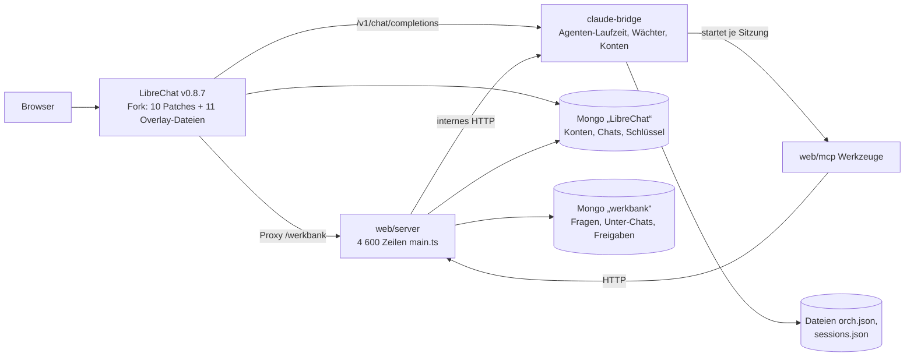
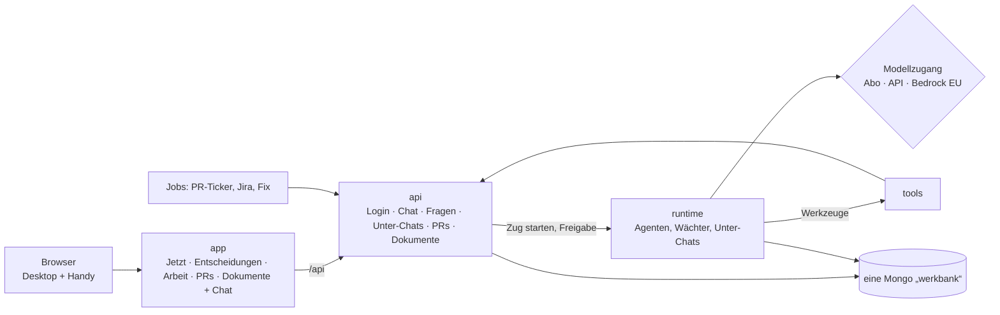
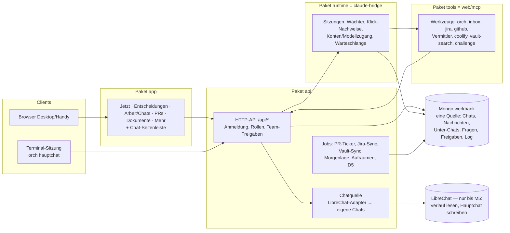

# Werkbank 2.0 — eine App statt vieler Orte

Stand 03.11.2026 · Grundlage: Abnahme R31 (20 echte Anfragen vom 02.11.), Persona-Test Paket 428 (Runde 1: Knut 0 von 6 Aufgaben ohne Reibung, Lisa 0 von 6), UX-Test Paket 422, Vergleich Paket 430, R33 Paket 427.

## 1. Wofür es die Werkbank gibt

Knut gibt Arbeit an Agenten ab und entscheidet, was sie nicht selbst entscheiden dürfen. Die Werkbank muss ihm in jedem Moment drei Dinge sagen: **was jetzt von mir gebraucht wird**, **was gerade läuft** und **was fertig ist** — und ihm erlauben, im selben Bild zu antworten oder nachzufragen. Alles andere (Board, Sprint, Ziele, Skills, Einrichtung, Betrieb) ist Werkzeug für Ausnahmen, nicht Startseite.

## 2. Knuts Kern-Workflows

| # | Workflow | Heute (Paket 428) | In 2.0 |
|---|---|---|---|
| W1 | **Was ist offen, wo fange ich an?** (mehrmals täglich) | drei verschiedene Zahlen auf einem Bildschirm, „Fang hier an“ = fünf gleiche Push-Karten | Startseite: oben „Was du jetzt tun musst“, höchstens 5, wichtigste zuerst, **eine** Zahl |
| W2 | **Entscheiden** — Empfehlung übernehmen oder eigenen Text schicken | Massen-Knopf im Daumenbereich, Antwort landet an der falschen Karte | jede Entscheidung als Karte: Empfehlung · „Ja, so“ · „Anders: …“; Karte bleibt stehen und zeigt „✓ ging an …“ |
| W3 | **Nachfragen** — „Was ist das?“, „was meinst du damit?“ | Hauptchat ist eine eigene Welt, „Was ist das?“ wartet stumm | „Was ist das?“ erklärt sofort aus den Daten; „Im Chat fragen“ öffnet den Hauptchat als Seitenleiste mit vorbereiteter Frage |
| W4 | **Was ist heute fertig geworden?** | „fertig“ mischt „wartet auf dein Review“, Uhrzeit = Ladezeit | „Heute erledigt“ nur Fertiges, mit echter Uhrzeit und Link auf Bericht/Dokument |
| W5 | **Wie steht Unter-Chat X, muss ich etwas tun?** | rohes Markdown, „D4 beantworten“ ohne D4 | Arbeit-Ansicht: Zustand in einem Satz, offene Frage direkt an der Karte |
| W6 | **Welche PRs brauchen mich (oder Person X)?** | 38 PRs, selbst nach Namen suchen | PR-Liste „wartet auf: ich ▾“, Vorgabe = ich, umschaltbar auf jede Person |

Dazu für das Team: **Lisa** (neu) findet sich ohne Fachwörter zurecht und findet Dokumente; **Christoph** (Reviewer) sieht ohne eigenes Claude-Abo, was auf ihn wartet. Unterwegs (nur Handy): die wichtigste Entscheidung in unter 30 Sekunden.

## 3. Informationsarchitektur

**Eine Startseite („Jetzt“).** Nach dem Login landet man immer hier, nie im leeren Chat.
1. **Was du jetzt tun musst** (≤ 5, die Zahl daneben ist die einzige Zahl der Seite) — Entscheidungen mit Empfehlung, sortiert nach „hält Arbeit an“ und „wichtig“, höchstens zwei Freigaben darunter.
2. **Läuft gerade** — Unter-Chats mit Satz „woran“ und voraussichtlichem Ende.
3. **Heute erledigt** — nur Fertiges, je mit Link.
4. **PRs, die auf dich warten.**
5. **Neue Dokumente** — Berichte und Dateien, immer als Link.

**Links nur fünf Bereiche:** Jetzt · Entscheidungen · Arbeit · PRs · Dokumente. **Der Chat** ist kein Bereich, sondern eine Seitenleiste auf jeder Seite (am Handy: Knopf unten rechts, öffnet von unten). Oben rechts „?“ = Begriffe in Klartext.

**Jede Karte** hat dieselben Teile: Titel in Klartext · ein Satz „worum“ · Links (Bericht, Dokument, PR) · „Was ist das?“.

**Fällt weg (in 2.0, die alte Werkbank behält es):** Leitstand, Morgenlage, Tageskarte, Lage, Übersicht, Fang-hier-an als eigene Seite, Timebox, Ablage-Ansicht, Massen-Antwort-Knopf, Kontingent auf der Startseite. Board, Sprint, Ziele, Wissen, Skills, Einrichtung bleiben in der alten Werkbank erreichbar (Link „Alte Werkbank“ im Menü).

## 4. Begriffe (in der Oberfläche nur diese)

| Wort in 2.0 | Bedeutet | ersetzt |
|---|---|---|
| **Chat** (bei Knut: **Hauptchat**) | dein Gespräch mit dem Assistenten, der die Arbeit verteilt | Leitstand, Orchestrator, Koordinator |
| **Unter-Chat** | ein Auftrag, an dem ein Agent selbstständig arbeitet | Strang, Lauf, Session |
| **Wartet auf dich** | etwas, das ohne deine Antwort nicht weitergeht | Braucht dich, Braucht Knut, Inbox |
| **Entscheidung** | Frage mit Empfehlung; „Ja, so“ oder „Anders: …“ | D1, Rückfrage, Freigabe-Karte |
| **Freigabe** | Erlaubnis für einen Schritt nach außen (z. B. Push auf GitHub) | Push freigeben, Gate |
| **Dokument** | alles Lesbare: Bericht, Notiz, Datei | Vault-Notiz, Review-Paket, Ablage |

## 5. Architektur

### 5.1 Ist-Bild

| Kopplung | Was hängt dran | Fehlerquelle der letzten Wochen |
|---|---|---|
| **LibreChat als Hülle** | Login, Chatverlauf, Streaming, Seitenleiste; die Werkbank-Oberfläche wird als `/werkbank` durchgereicht, Antwortknöpfe und Chat-Kopf sind Patches im LibreChat-Client | jede Oberflächenänderung am Chat = Patch + Client-Neubau (1–2 min) + Neustart; 12 von 47 Commits seit 06.10. betreffen `librechat/`; Hauptchat lud 20 s (Desktop) bzw. 2 min (Handy), R33 musste das im fremden Client umbauen |
| **Zwei Datenbanken** | web/server liest LibreChats Mongo direkt (`users`, `sessions`, `messages`, `conversations`, `keys`) und schreibt Claude-Token in LibreChats `keys` | Schema-Abhängigkeit von einer fremden App; Zahlen aus zwei Quellen laufen auseinander (W1 in 428) |
| **Zustand in Dateien** | Brücke hält Unter-Chats und Sitzungen in `orch.json`/`sessions.json`, web/server spiegelt Unter-Chats in Mongo | zwei Wahrheiten über „läuft/fertig“; R32 musste „Strangzustand = Wahrheit der Brücke“ nachziehen |
| **Ein großer Server** | `web/server/main.ts` 4 600 Zeilen: Routen für Oberfläche, Ticker, Jira, Fix-Pushes, Betrieb, Chief of Staff | ein Fehler in einem Teil = Neustart des Ganzen; Release mit Drain, weil Neustarts laufende Unter-Chats abbrachen (31× in 14 Tagen, Plan 213) |
| **Schalter** | rund 135 verschiedene `BRIDGE_*`/`WERKBANK_*`-Variablen; Doppelungen (`WERKBANK_URL`/`WERKBANK_BRIDGE_URL`/`BRIDGE_URL`, drei Arten Trockenlauf) | Verhalten hängt am Schalterstand; Test-Instanzen brauchen eine eigene Sperrliste von 40 Zeilen |

### 5.2 Fragen und Antworten

**Brauchen wir LibreChat noch?** Nein, auf Sicht nicht. Was wir von LibreChat wirklich nutzen, sind Login, Chatverlauf und das Streaming-Fenster. Die Agenten-Laufzeit, die Wächter, die Freigaben und alle Ansichten sind schon unsere. Der Chat-Endpunkt der Brücke ist OpenAI-kompatibel, web/server ruft ihn bereits selbst auf („Agent ansetzen“). Ein eigener Chat-Teil ist also klein: Nachricht speichern, Zug auf der Brücke starten, Antwort mitschreiben, Browser liest mit. Was wir verlieren: Teilen-Links, Volltextsuche im Chatverlauf, Datei-Upload im Chat, LibreChats Agenten-Marktplatz — nichts davon steht in Knuts Workflows; Upload und Suche kommen als eigene, kleine Teile, wenn sie gebraucht werden.

**Ein Repo oder mehrere?** Ein Repo mit klaren Paketen (npm-Workspaces), nicht getrennte Repos. Begründung: ein Hauptentwickler, Änderungen gehen fast immer über Laufzeit + API + Oberfläche gleichzeitig; getrennte Repos machen jede solche Änderung zu drei PRs mit Versionsabgleich. Die Grenzen sichern Paketgrenzen mit eigenen Tests und eine Importregel („app importiert nie aus api“), nicht Repo-Grenzen.

| Paket | Inhalt | Grenze |
|---|---|---|
| `runtime` (heute `claude-bridge`) | Agenten-Laufzeit, Wächter, Konten, Unter-Chats, **Modellzugang** | spricht nur HTTP nach außen; keine Oberfläche |
| `api` (heute `web/server`) | eine HTTP-API: Login, Chat, Fragen, Unter-Chats, PRs, Dokumente; Hintergrundjobs (Ticker, Jira, Fix) als eigene Module | einzige Stelle mit Datenbankzugriff |
| `app` (neu, heute `web/app`) | die 2.0-Oberfläche inkl. Chat | nur über `api`, nie direkt Brücke oder DB |
| `tools` (heute `web/mcp`) | Werkzeuge der Agenten | nur über `api` |
| `shared` | Typen der API, Begriffe, Schalter-Schema | ohne Laufzeit-Abhängigkeiten |

**Ein Deploy-Weg.** `npm run build` (alle Pakete) → ein Neustart mit Drain. Kein Patch, kein Client-Neubau. Die App ist eine statische Datei-Ablage, die die API ausliefert; Oberflächenänderungen brauchen gar keinen Neustart der Laufzeit.

**Konfiguration.** Ein Schalter-Schema in `shared` mit drei Klassen: *Betrieb* (Ports, Pfade — Pflicht, ohne Vorgabe), *Sicherheit* (Sperren wie Push/Jira-Schreiben — Vorgabe „aus“, nur bewusst an), *Funktion* (neue Funktionen — jeder Schalter mit Ablaufdatum; nach zwei Wochen „an“ wird er gelöscht und die Funktion ist Standard). Start bricht ab, wenn ein unbekannter Schalter gesetzt ist.

**Daten.** Eine Datenbank `werkbank` als einzige Quelle für Personen, Chats, Nachrichten, Fragen und Unter-Chats; `orch.json`/`sessions.json` wandern in Collections (die Brücke schreibt, die API liest). Während des Umstiegs liest die API LibreChats Verlauf nur noch lesend.

**Team-Fähigkeit.** Eine Instanz für alle, nicht je Person eine. Lesen geht ohne Claude-Zugang (Lisa, Christoph); der Chat braucht einen Modellzugang. Rechte: *lesen* (Team) · *entscheiden* (wem die Frage gehört) · *Hauptchat* (Knut).

**Abo-Token-Risiko (Paket 430).** Die Laufzeit bekommt eine Schnittstelle „Modellzugang“ mit drei Möglichkeiten: Abo-Anmeldung (heute), API-Schlüssel, Bedrock/Vertex in der EU-Region. Welcher Weg gilt, entscheidet Knut (430 D1); die Architektur hängt nicht mehr davon ab.

### 5.3 Zielbild

### 5.4 Migrationspfad (die alte Werkbank läuft durchgehend weiter)

| Schritt | Was | Woran man merkt, dass es geht |
|---|---|---|
| **0 — heute Nacht** | `web/app` (eigene Vite-App, Route `/v2`), `web/server/v2*.ts` (eine schmale API für die App: Start, Arbeit, PRs, Dokumente, **Chat**: neue Chats direkt auf der Brücke, der bestehende Hauptchat über LibreChats Serverweg — ein Schreiber je Unterhaltung, siehe 5.5), Begriffe und Rangregel als getestete Module. Nur auf einer Test-Instanz mit Datenkopie. | Persona-Test Runde 1/2 gegen die Messlatte aus 428 |
| 1 | `/v2` mit dem nächsten Release in die Live-Werkbank (ohne Schalter: neue Route stört nichts). Knut nutzt 2.0 und alt parallel. | Knut stellt „was ist offen?“ einen Tag lang nicht mehr |
| 2 | Hauptchat-Umstieg: der Hauptchat wird in 2.0 geführt (eigener Verlauf in `werkbank`), der LibreChat-Hauptchat wird schreibgeschützt. Unter-Chats starten als 2.0-Chats. | eine Woche ohne Wechsel in LibreChat |
| 3 | Eigenes Login (Konten aus LibreChat übernommen, Passwort-Hash bleibt gültig), npm-Workspaces und Paketumzug (`packages/runtime`, `api`, `app`, `tools`, `shared`), Schalter-Schema | `npm test` an der Wurzel prüft alle Pakete |
| 4 | `orch.json`/`sessions.json` in die Datenbank; Modellzugang als Schnittstelle | ein Zustand für „läuft/fertig“ |
| 5 | LibreChat abschalten (Verlauf bleibt lesbar exportiert), Patches und Overlay löschen | Deploy ohne Client-Neubau |

**Heute Nacht nicht:** Paketumzug und Workspaces (würde Live-Pfade und Skripte verschieben), eigenes Login (Login läuft weiter über das bestehende `/api/login`), Datenbank-Umzug der Brücke, Schalter-Aufräumen, Modellzugang. Begründung: Jeder dieser Schritte berührt Live-Betrieb; der 2.0-Stand soll schon im Zielbild liegen (eigene App, eigener Chat-Teil), ohne die alte Werkbank zu verändern.

### 5.5 Council zu Schritt 0 (03.11.2026)

Rollen: Befürworter, Fachprüfung, Advocatus Diaboli (zweites Modell: GLM 5.3 über Melious), Abschluss. **Urteil: HOLD — bauen, mit diesen Bedingungen** (Zuversicht 0,7; die Richtung trägt, aber der Chat ist der riskanteste Teil):

1. **Ein Schreiber je Unterhaltung.** Der bestehende Hauptchat und die Unter-Chats bleiben LibreChat-Unterhaltungen; 2.0 liest sie und schreibt in sie nur über LibreChats eigenen Serverweg (derselbe wie „Agent ansetzen“, `createLibreChat`). Neue 2.0-Chats laufen direkt auf der Brücke mit **eigener** Unterhaltungs-ID — nie eine LibreChat-ID wiederverwenden. Beides hinter einer Schnittstelle „Chatquelle“, damit Schritt 2 nur die Quelle tauscht.
2. **Züge laufen auf dem Server, nicht im Browser.** Die API startet den Zug, schreibt die Antwort fortlaufend in die Datenbank, der Browser liest nach (übersteht Netzwechsel am Handy). Ein Zug, der beim Neustart der API offen war, wird beim Start als „abgebrochen“ markiert und so angezeigt — nie stilles Hängen.
3. **Alle v2-Routen hinter der bestehenden Anmeldung** (`needUser`, Freigabeliste, `x-werkbank`-Kopf bei POST); Chat: höchstens ein laufender Zug je Person, Text ≤ 8 000 Zeichen; Hauptchat nur für Admin.
4. **Keine Freigabe nach außen in 2.0.** Push-/Jira-Karten erscheinen mit Link „in der alten Werkbank freigeben“; Antworten auf Fragen gehen über die bestehende Route `POST /api/entscheidungen/fragen/antwort` — mit Test.
5. **LibreChat-Zugriff nur in einem Modul** (Adapter); kein anderes v2-Modul liest LibreChats Datenbank.
6. **Importregel als Test:** `web/app` importiert nichts aus `web/server`, `claude-bridge` oder `web/src`.
7. **Handy wird gemessen**, nicht behauptet: Persona-Test auf 390 px ist Teil von Schritt 0.
8. **Kein Verschieben** von Verzeichnissen, Skripten oder Live-Pfaden heute Nacht.

Stärkster Einwand, sichtbar gelassen: Solange 2.0 LibreChat-Unterhaltungen liest, bleibt die Schema-Abhängigkeit bis Schritt 5 bestehen — der Adapter (Bedingung 5) begrenzt sie, beseitigt sie nicht.

## 6. Was 2.0 heute Nacht kann (und was nicht)

Kann: Startseite mit einer Zahl, Entscheidungen mit „Ja, so“ / „Anders: …“ über die bestehenden Antwortwege, „Was ist das?“ sofort, Arbeit (Unter-Chats) lesen, Heute erledigt, PRs „wartet auf …“, Dokumente mit Suche, Hauptchat als Seitenleiste, Lesen ohne Claude-Zugang. Nicht: Freigaben nach außen (Push, Jira) — der Knopf führt in den Chat bzw. die alte Werkbank, die Schreibwege bleiben die bestehenden der Brücke mit denselben Prüfungen; Board, Sprint, Einrichtung.

---

# Teil 2 — Plan v2: Architektur und Vollausbau (03./04.11.2026)

**Quelle:** Knuts Feedback zur Test-Instanz (03.11. abends, Punkte 1–7, Nachträge 1–6), Nutzungs-Audit (Paket 437), Abnahme-Checkliste `nicht-verlieren.md` (Paket 436). **Jira:** keins (Werkbank-intern; Knut: keine Tickets ohne Auftrag). **Stand des Codes:** Schritt 0 gebaut (Teil 1, Commits `2a1ba8e`…`d4a48fb`), dazu der D5-Kern (`18dc371`); Bau ab Nachtrag 5 angehalten, bis dieser Plan reviewt ist.

## 7. Ziel und Abgrenzung

**Ziel.** Die 2.0 wird die eine Oberfläche, mit der Knut **und** das Team (Lisa neu, Christoph Reviews) ohne Erklärung arbeiten. „Jetzt“ (sortierte Top-Liste quer über alle Themen, sofort entscheiden) bleibt der Kern. Nichts aus der alten Werkbank geht stillschweigend verloren: jede Zeile der Abnahme-Checkliste ist einem Paket und Schnitt zugeordnet (§16) und hat am Ende einen Stand mit Beleg.

**Knuts Punkte (03.11. abends).** 1 „Jetzt“ bleibt · 2 Themen-Cluster für Entscheidungen, Unter-Chats, Dokumente, PRs · 3 alle Haupt- und Unter-Chats auffindbar (Suche, Thema, Datum, Status), von jeder Karte in den Chat · 4 Inventar aller Funktionen, Nutzungs-Audit entscheidet „heben oder streichen“ · 5 Startansicht je Rolle, Fachwörter ersetzt, Team-Freigaben respektiert · 6 /werkbank-Pfad, eine Wortwahl für die Zahl, D5, Jargon raus, kurze Handy-Startseite · 7 Persona-Runden.

**Nicht in diesem Plan:** Push, PR, Live-Neustart (erst auf Knuts Go); Geld und Rechtliches; die Modellzugangs-Entscheidung (E7, Knut).

## 8. Ist-Befund in Zahlen

| Befund | Zahl | Beleg |
|---|---|---|
| Schalter (gelesene Umgebungsvariablen in web/server, web/mcp, claude-bridge/src, scripts) | ca. 330 (Präfix WERKBANK ca. 160, BRIDGE ca. 55, Rest LEITSTAND/COS/ORCH/MELIOUS/…) | Inventar per Lesezug (Melious, 03.11.); genaue Zählung am Code steht in M3 an |
| Doppelte Schalter | 13 Gruppen (z. B. drei Namen für die Brücken-URL, vier Arten Trockenlauf, zwei Sätze für die OLAF-Jira-Seite) | `web/server/config.ts:21–98`, `web/server/jirawrite.ts:22`, `web/server/prfix.ts:28` |
| Doppelte Wahrheiten im Datenmodell | 5: Strangstatus (Brücken-Datei + `orchestrator_runs` + Live-Korrektur), Chatverlauf (LibreChat-Nachrichten + Kopien), Frage-Abschluss (`orchestrator_questions` + `entscheidungs_log`), Nutzung (4 Zähler), Konto/Freigabe (Brücken-Datei + `creds` + LibreChat-Schlüsselspeicher) | Lesezug Datenmodell; `web/server/strangwahrheit.ts` |
| LibreChat-Anpassungen | 10 Patches + 11 Overlay-Dateien, LibreChat v0.8.7, Client-Neubau 1–2 min bei jeder Änderung | `librechat/patches/`, `scripts/librechat-patch.sh` |
| Server | `web/server/main.ts` ca. 4 600 Zeilen, rund 200 Routen | Teil 1 §5.1 |
| Nutzung (14 Tage) | 1 004 Hauptchat-Züge, 115 Unter-Chats, 148 Nachreichungen, 3 Antworten an Karten; Board/Sprint/Ziele/Mein Tag/Skills ≈ 0 | Paket 437 |

## 9. Zielbild

**Regeln des Zielbilds:** app spricht nur mit api · nur api und runtime schreiben die Datenbank · LibreChat nur hinter dem Adapter (Teil 1 B5) · jede Schreibaktion nach außen (GitHub, Jira, Coolify, Vaultwarden) bleibt in runtime/tools mit den heutigen Wächtern und Klick-Nachweisen.

## 10. Große Entscheidungen — je mindestens zwei Alternativen

Aufwand in Personentagen eines Agenten-Strangs (PT); Risiko = was bricht, wenn es schiefgeht.

### E1 Chat: mit oder ohne LibreChat

| Option | Aufwand | Risiko | Kosten/Verlust |
|---|---|---|---|
| a) LibreChat bleibt Hülle für alle Chats, 2.0 nur Seiten (heute) | 0 | Patches und Client-Neubau bleiben; Hauptchat-Ladezeit bleibt LibreChat-Sache | jede Chat-UX-Änderung = Patch |
| **b) schrittweise: neue Chats in 2.0, Hauptchat über Adapter, dann Umstieg (M2) und Abschalten (M5)** | M2 ≈ 3 PT, M5 ≈ 2 PT | Umstiegsfehler im Hauptchat → Rückweg: Adapter bleibt bis M5 | in 2.0 nachzubauen: Anhänge (≈ 1 PT, die Brücke kann es schon: `claude-bridge/src/attachments.ts`), Suche über alle Chats (≈ 1 PT, Mongo-Textindex), Vorlagen (S17), Teilen (≈ 1 PT, nur wenn genutzt) |
| c) sofort ohne LibreChat (Hauptchat sofort umziehen) | ≈ 5 PT in einem Zug | großer Knall im meistgenutzten Weg (1 004 Züge in 14 Tagen) | alles aus b) auf einmal |

**Empfehlung b)** — der meistgenutzte Weg wird nicht über Nacht umgebaut; jede Stufe hat einen Rückweg. Teil 1 B1 gilt weiter: ein Schreiber je Unterhaltung.

### E2 Paketschnitt

| Option | Aufwand | Risiko |
|---|---|---|
| **a) ein Repo, npm-Workspaces: `packages/app`, `api`, `runtime`, `tools`, `shared`; Importregeln als Test** | ≈ 2 PT (Umzug + Skripte) | Pfade in Skripten und Live verschieben sich → nur in einem Release mit Rückweg (M3) |
| b) getrennte Repos je Paket | ≈ 4 PT + Versionsabgleich je Änderung | jede Querschnittsänderung = 3 PRs; ein Hauptentwickler |
| c) wie heute (web/, claude-bridge/), nur Importregeln | 0,5 PT | Wildwuchs bleibt, `main.ts` wächst weiter |

**Empfehlung a)**, aber erst in M3; heute Nacht gilt c) (Importregel-Test besteht, Teil 1 B6). Gegen Monorepo-Wildwuchs: jedes Paket hat genau eine Aufgabe (§9) und eigene Tests; `api` wird beim Umzug in Module je Funktionsgruppe zerlegt (Routengruppen aus dem Inventar), nicht 4 600 Zeilen in einer Datei.

### E3 Datenmodell — eine Quelle für Chats, Fragen, Stränge

| Option | Aufwand | Risiko |
|---|---|---|
| **a) eine Mongo `werkbank`: `chats`, `nachrichten`, `unterchats` (heute `orchestrator_runs`), `fragen` (+ Pakete), `freigaben`, `log`; die Brücke schreibt Sitzungs- und Strangzustand dorthin statt in ihre Dateien** | ≈ 4 PT (M4) | Migration der Brücken-Dateien; Rückweg: Dateien werden bis M5 parallel geschrieben (Schatten), Abgleich-Test |
| b) wie heute (Dateien in der Brücke, Mongo-Spiegel, Live-Korrektur) | 0 | drei Schreibstellen für „läuft/fertig“ bleiben (Ursache von R32-Fehlern) |
| c) Ereignis-Log (nur anhängen) + daraus berechnete Ansichten | ≈ 8 PT | neu für das Team, Projektionen müssen nachgezogen werden |

**Empfehlung a)**. Die fünf doppelten Wahrheiten (§8) werden je auf eine Stelle reduziert: Strangstatus → `unterchats` (Brücke schreibt), Verlauf → `nachrichten` (ab M2), Frage-Abschluss → `fragen.status` (Log nur Protokoll), Nutzung → ein Zähler, Freigabe → `freigaben` (Brücke prüft den Klick-Nachweis dagegen).

### E4 Deploy

| Option | Aufwand | Risiko |
|---|---|---|
| **a) `npm run build` an der Wurzel, ein Neustart mit Drain (heute schon in `scripts/werkbank.sh:56–77`); die App ist statisch (Oberflächenänderungen ohne Neustart)** | ≈ 1 PT (ab M3) | — |
| b) Container je Paket (Coolify) | ≈ 3 PT | Box-Speicher, neue Betriebsart |
| c) wie heute (`werkbank.sh update`, LibreChat-Client-Neubau bei Patch-Änderung) | 0 | 1–2 min Neubau, Patches brechen bei LibreChat-Updates |

**Empfehlung a)**; der Rückweg „zurueck“ (Release-Zweig auf den vorigen Stand + `update`) bleibt.

### E5 Schalter

| Option | Aufwand | Risiko |
|---|---|---|
| **a) Schalter-Schema in `shared`: drei Klassen (Betrieb Pflicht ohne Vorgabe · Sicherheit Vorgabe „aus“ · Funktion mit Ablaufdatum), unbekannter Schalter = Startabbruch mit Klartext; Doppelungen auf einen Namen mit Übergangsalias** | ≈ 2 PT | ein vergessener Alias stoppt den Start → Abbruch mit Klartext, Test über die Beispieldatei |
| b) nur die 13 Doppelgruppen zusammenlegen | ≈ 0,5 PT | Wachstum geht weiter |
| c) Schalter in die Datenbank (Oberfläche) | ≈ 3 PT | Sicherheits-Schalter per Klick änderbar — nicht gewollt |

**Empfehlung a)** in M3; Funktionsschalter mit Vorgabe „an“ (z. B. `WERKBANK_PR_TICKER`, `ORCH_AUTO_WEITER`, `BRIDGE_NACHREICHEN`) werden Standard und verlieren den Schalter.

### E6 Team-Fähigkeit

| Option | Aufwand | Risiko |
|---|---|---|
| **a) eine gemeinsame Instanz, Rechte je Rolle (lesen · entscheiden · Hauptchat), Team-Freigaben wie heute; Chat braucht eigenen Modellzugang** | ≈ 2 PT (Rollen in api, M3) | Datentrennung zwischen Personen muss stimmen → Test je Route „nur eigene“ |
| b) Instanz je Person (heute `scripts/team-install.sh`) | 0 (vorhanden) | je Person 16 GB Box, Updates je Instanz |
| c) gemischt: gemeinsame Lese-Instanz fürs Team, Knut behält seine | ≈ 1 PT | zwei Wahrheiten über PRs und Dokumente |

**Empfehlung a)** für Lesen und Entscheiden; b) bleibt als Weg für Personen mit eigener Agentenarbeit.

**Entschieden (Knut 03.11. ~23 Uhr, D8): b) persönlich.** Jede Person hat ihre eigene Instanz, keine geteilte; das System richtet nur ein (`scripts/team-install.sh`). Das Gemeinsame — Wissen, Entscheidungen, Register — liegt im Vault. Lesen ohne eigenes Claude-Abo bleibt in der eigenen Instanz möglich. Folgen für den Bau:
- Die Rolle (Startansicht) hängt nicht am Admin-Flag — in der eigenen Instanz ist jede Person Admin. Reihenfolge: Einstellung `WERKBANK_ROLLE` (setzt team-install: `leitung` · `reviewer` · `team`) → sonst aus den Daten: Admin **mit** Claude-Zugang = leitung, GitHub-Name bekannt = reviewer, sonst team.
- Team-Freigaben (`WERKBANK_TEAM_FEATURES`) bleiben für Gast-Konten in einer Instanz gültig (Test-Instanz), verlieren aber an Gewicht.
- Option a) (gemeinsame Instanz mit Rechten je Rolle) entfällt; C8/E9 bleiben je Instanz.

### E7 Modellzugang (Abo-Token-Risiko) — **Knuts Entscheidung, Halt**

**Entschieden (Knut 03.11.): bleibt wie er ist (a).** Keine Umstellung, nichts dazu bauen.

| Option | Aufwand | Risiko |
|---|---|---|
| a) Abo-Token je Person (heute, `claude setup-token`) | 0 | Nutzungsbedingungen des Abos für Agentenbetrieb (Paket 430); Rate-Limits je Konto |
| b) API-Schlüssel der Firma | ≈ 1 PT (die Brücke kennt API-Schlüssel schon für Melious) | Kosten je Token |
| c) Bedrock/Vertex in EU-Region | ≈ 2 PT | Einrichtung, Kosten, Modellverfügbarkeit |

Die Architektur trennt den Modellzugang als Schnittstelle in runtime ab (M4), damit der Wechsel ein Konfigurationsschritt wird. **Keine Arbeitsannahme** — Geld und Recht, Knut entscheidet (430 D1).

### E8 Alte Funktionen (Board, Sprint, Ziele, Mein Tag, Morgenlage, Roadmap-Pflege, Ablage/Teilen, Einrichtung, Skills-Seite)

| Option | Aufwand | Risiko |
|---|---|---|
| **a) in 2.0 über „Mehr“ verlinkt (gleiche Anmeldung, gleicher Server), Stand „erreichbar (alte Seite)“; Kurzansichten, wo sie gebraucht werden (meine Jira-Tickets, Heute erledigt mit Datum)** | ≈ 1 PT | Verlinken ist eine Option mit Ablaufdatum (Council C5): vor M5 je Seite neu entscheiden |
| b) alles in 2.0 neu bauen | ≈ 10 PT | baut Ungenutztes nach (Audit: ≈ 0) |
| c) laut Audit streichen (Ziele, Mein Tag, Sprint, Skills-Seite, Hygiene, Lage) | ≈ 0,5 PT | etwas Gebrauchtes fehlt plötzlich (Ziele und Sprint stehen auf Knuts Checkliste) |

**Empfehlung a)**, Streichen nur auf Knuts Wort (D6).

## 11. Migrationspfad (neben der alten Werkbank)

| Schritt | Was | Woran man merkt, dass es geht | Rückweg |
|---|---|---|---|
| M0 (Teil 1, gebaut) | `/v2` auf der Test-Instanz | Persona-Runden 436 | — |
| **M0b (heute Nacht)** | Schnitte S10–S18 (§12) | Persona-Runde 3, Abnahmetabelle | lokale Commits, nichts live |
| M1 | `/v2` mit dem nächsten Release live, alt und neu parallel | Knut startet eine Woche in `/v2` | Link auf `/v2` entfernen |
| M2 | Haupt- und Unter-Chats in 2.0 (eigener Verlauf), Anhänge, Suche, Vorlagen, Handy-Benachrichtigung; LibreChat-Hauptchat schreibgeschützt | eine Woche ohne Wechsel in LibreChat | Adapter wieder Schreiber |
| M3 | Pakete (E2), eigenes Login (Passwort-Hash aus LibreChat übernommen), Rollen (E6), Schalter-Schema (E5) | `npm test` an der Wurzel prüft alle Pakete | Release-Zweig zurück |
| M4 | Datenmodell (E3), Modellzugang-Schnittstelle (E7) | ein Zustand für „läuft/fertig“, Abgleich-Test grün | Schatten-Dateien bis M5 |
| M5 | LibreChat abschalten (Verlauf exportiert), Patches und Overlay löschen; jede verlinkte alte Seite neu entschieden | Deploy ohne Client-Neubau | Export lesbar, LibreChat-Daten gesichert |

## 12. Schnitte für heute Nacht (M0b)

Reihenfolge nach Wirkung; je Schnitt: Test zuerst, Review (olaf-code-review + zweites Modell), Persona-Lauf, Screenshots Desktop/390 px. „Lieber drei fertige als fünf halbe“ (Knut, Nachtrag 6).

| S | Was | DoD |
|---|---|---|
| S10 | D5: entschiedene Paket-Fragen schließen (C1, C2) | Test: nur bei gleicher Anzahl **und** passendem Inhalt; sichtbar „automatisch geschlossen“ mit Wieder-öffnen; Lauf im 10-min-Takt |
| S11 | Themen überall | Filter + Gruppen auf Entscheidungen, Arbeit, PRs, Dokumente; „Jetzt“ quer; Test je Quelle |
| S12 | Alle Chats (C4) | Reiter „Alle Chats“: Unter-Chats, Hauptchats, alle LibreChat-Unterhaltungen der Person, Suche/Thema/Status/Datum; Chat-Ansicht lesen + schreiben (bestehende Wege `sendOrch`/`deliver`); jede Karte → Chat |
| S13 | Rollen und Klartext (C6) | Rolle aus Daten (Reviewer = GitHub-Name); Startansicht je Rolle; Jargon-Wörterbuch; eine Wortwahl „warten auf dich“ |
| S14 | Mehr (C5) | jeder Eintrag der alten Navigation, Kurzansichten Jira (meine offen/überfällig), Heute erledigt mit Datum; Test gegen `web/src/App.tsx` |
| S15 | Entscheiden vollständig | „alle wie empfohlen“ je Thema (nie Freigaben), Notiz zu „Ja, so“, „Im Chat besprechen“ |
| S16 | Pfad und Handy (C3) | `/werkbank/v2` lauffähig mit Präfix-Erlaubnisliste; kurze Handy-Startseite |
| S17 | Vorlagen und Skill-Nachweis (C7) | Vorlage im neuen Chat; gemessene Skill-Gleichheit |
| S18 | Abnahme | Tabelle je Checklistenzeile mit Beleg, Persona-Runde 3, Pre-Push-Gate, PR-Text, kein Push |

## 13. Entscheidungen (Grilling, eine Runde) — Arbeitsannahmen nach Nachtrag 6

Selbst entschieden (mit Zeile für Knut):
- G1 Navigation: Jetzt · Entscheidungen · Arbeit (Reiter „Offen“ / „Alle Chats“) · PRs · Dokumente · Mehr; Handy: 5 Symbole + „Mehr“.
  - Knut:
- G2 „Alle wie empfohlen“ nur je Thema, mit Bestätigung, nie für Freigaben, nicht unten im Daumenbereich (428 W5).
  - Knut:
- G3 Jede Karte hat „Im Chat besprechen“ (Audit 437: Entscheidungen fallen meist im Chat).
  - Knut:
- G4 Rolle aus Daten (C6); Lisas Start: „Neu hier“, Dokumente, Begriffe; Christophs Start: seine PRs oben.
  - Knut:

An Knut — **angenommen, Knut kann widersprechen** (gebaut wird mit der Empfehlung, Umschwenken bleibt billig):
- D1–D4 aus Runde 1 (Bericht 436): Grundsätze, Team-Freigaben, Live-Ausrollen, Hauptchat-Umstieg — Empfehlungen gelten.
- D6 Alte Funktionen: **verlinken (E8 a)**, nichts streichen ohne Knut.
- D7 Handy-Benachrichtigung (gibt es heute nicht): **nicht in M0b**, Vorschlag M2.
- D8 Team: ~~gemeinsame Instanz (E6 a)~~ → **Knut: eigene Instanz je Person (E6 b), Gemeinsames im Vault**.
- D9 Chat-Weg: **schrittweise (E1 b)**.
- D10 Paketschnitt und Datenmodell: **E2 a in M3, E3 a in M4**.

Halt (keine Annahme): **E7 Modellzugang** (Geld/Recht, Abo-Token-Frage) · Push/PR · Live-Werkbank.

## 14. Weitere große Entscheidungen (aus dem Plan-Review)

### E9 Anmeldung und Sitzungen

| Option | Aufwand | Risiko |
|---|---|---|
| **a) bis M3 wie heute: LibreChat-Login, Werkbank-Sitzung `wb_session` (Hash in `werkbank.sessions`); ab M3 eigenes Login mit übernommenem Passwort-Hash, Sitzung 30 Tage, Abmelden je Gerät** | ≈ 2 PT (M3) | Passwort-Hash-Format von LibreChat (bcrypt) muss passen → Test mit echtem Hash aus der Kopie |
| b) Anmeldung über Coder/Workspace-Identität | ≈ 1 PT | bindet die Werkbank an Coder; Team ohne Coder-Konto ausgeschlossen |
| c) Magic-Link per Mail | ≈ 2 PT | Mailversand nötig (heute gesperrt), Verzögerung am Handy |

**Empfehlung a)**. Der Terminal-Weg (`orch hauptchat`, Zielbild §9) nutzt denselben internen Kanal wie heute (`/internal/*` mit Token, nur lokal) — kein Browser-Login, keine Freigaben über diesen Weg (bindend, C11).

### E10 Datensicherung und Wiederherstellung

| Option | Aufwand | Risiko |
|---|---|---|
| **a) nächtlicher Mongo-Dump beider Datenbanken + Brücken-Zustand in die Ablage (heute: Backup-Download, Nachtsicherungen in der alten Seite „Dateien“), Aufbewahrung 14 Tage; einmal geübte Wiederherstellung in eine Test-Instanz vor M4** | ≈ 1 PT | Dump während Schreiben → `--oplog` nicht verfügbar ohne Replikat; Abgleich-Test nach Wiederherstellung |
| b) Mongo als Replikat-Satz mit zweitem Knoten | ≈ 2 PT + Speicher | Box-Speicher |
| c) nur der Backup-Download wie heute | 0 | keine geübte Wiederherstellung; M4 macht Mongo zur alleinigen Wahrheit |

**Empfehlung a)**; M4 beginnt erst nach einer geübten Wiederherstellung, M5 (Löschen) erst danach (C10).

### E11 Audit-Log für Schritte nach außen

| Option | Aufwand | Risiko |
|---|---|---|
| **a) eine Collection `audit` (nur anhängen): Push, PR-Kommentar, Jira-Schreiben, Vaultwarden-Abruf, Coolify, mit wer · was · wann · Klick-Nachweis; Ansicht in 2.0 unter Mehr (nur Admin)** | ≈ 1,5 PT | heute verteilt (`freigaben`, `pr_fix_audit`, `jira_dryrun`, Brücken-Log) → bis zur Zusammenführung zeigt die Ansicht die bestehenden Quellen |
| b) nur Brücken-Log (JSON-Zeilen) | 0 | schwer durchsuchbar, keine Ansicht |
| c) externer Dienst | ≈ 2 PT | Daten verlassen die Box |

**Empfehlung a)** in M3; bis dahin verweist die Abnahme auf die bestehenden Quellen.

### E12 Suche

| Option | Aufwand | Risiko |
|---|---|---|
| **a) bis M2: Suche über Titel, Thema und Stand der Chats in Mongo (Regex, begrenzt); ab M2 Mongo-Textindex (deutsch) über 2.0-Nachrichten** | 0,5 PT + 1 PT | Volltext über alte LibreChat-Verläufe erst nach Export (M5) |
| b) Meilisearch weiter für Chats und Vault | 0 | Meili ist heute für Vault und LibreChat da; nach M5 nur noch Vault |
| c) keine Chat-Suche, nur Filter | 0 | Knut Punkt 3 nicht erfüllt |

**Empfehlung a)**, Vault-Suche bleibt wie heute (Meili oder Titel-Rückfall).

### E13 Sandbox für Unter-Chats (Nachtrag 7, feste Regel)

**Regel:** Unter-Chats laufen in einer eigenen Sandbox ohne Zugriff auf die Vaultwarden-Sitzung, den Git-Credential-Helper und `~/.ssh`; Schreib-Token gibt es nur im Server-Prozess für freigegebene GitHub-Aktionen (wie heute `githubwrite`/`gitsafe` mit Klick-Nachweis).

| Option | Aufwand | Risiko |
|---|---|---|
| a) eigener Unix-Nutzer je Unter-Chat-Lauf (sudo-Regel, eigenes HOME, Repos per Gruppenrecht) | ≈ 2 PT + Box-Einrichtung | Box-Änderung (sudoers, Nutzer) — Knut entscheidet (D11) |
| b) Container je Unter-Chat (docker vorhanden) | ≈ 3 PT | Speicher je Container auf einer 16-GB-Box; Mounts der Worktrees |
| **c) Stufe 1 sofort: Prozess-Härtung im Start der Unter-Chat-Sitzung — Umgebung gesäubert (keine Vaultwarden-Sitzung, kein SSH-Agent, keine Token-Variablen), eigenes HOME ohne Zugangsdateien, Git ohne Credential-Helper, Pfadwächter gegen Lesen der Zugangsorte; Stufe 2 = a) oder b)** | ≈ 1 PT | weich: ein Agent mit Shell kann einen Pfadwächter ausdrücklich umgehen wollen → deshalb Stufe 2 bindend vor M2 |

Geprüft am 03.11.: unprivilegierte Namensräume sind auf der Box gesperrt (`unshare -rm` → „Operation not permitted“, AppArmor-Schalter = 1), `bwrap`/`firejail` fehlen, `docker` und `systemd-run` sind da. **Empfehlung c) heute Nacht, a) als Stufe 2 (D11).** Test (S19): ein Unter-Chat-Prozess versucht `~/.ssh` zu lesen, die Vaultwarden-Sitzung zu nutzen und den Credential-Helper aufzurufen — jeder Versuch scheitert nachweislich.

### E14 Ergänzungen zu E1 (aus dem Review)

- **Laufende Kosten von a):** 12 von 47 Commits seit 06.10. betrafen `librechat/` (Teil 1 §5.1), jeder davon mit Client-Neubau.
- **Option d) LibreChat auf eine neue Version heben statt Abkehr:** ≈ 2 PT je Hauptversion, alle 10 Patches neu anpassen; löst Ladezeit und Patch-Last nicht. Nicht empfohlen.
- **Rückweg M2 (präzisiert):** M2 schreibt den Hauptchat nur noch in 2.0; Rückweg = LibreChat wieder Schreiber, der 2.0-Verlauf seit dem Umstieg wird als eine Zusammenfassungs-Nachricht in den LibreChat-Hauptchat gestellt (Skript, Teil der M2-DoD). Nach 14 Tagen ohne Vorfall ist M2 endgültig.

## 15. Bindende Bedingungen (Council C1–C7 + Plan-Review)

Aus dem Council zu Teil 2 (03.11. abends; Befürworter, Fachprüfung, Advocatus Diaboli = GLM 5.3, Abschluss; Urteil HOLD, Zuversicht 0,7):
- **C1** D5 schließt nur bei gleicher Anzahl **und** inhaltlicher Übereinstimmung je Paar; sonst bleibt alles offen.
  *Präzisiert beim Bau (S10, angenommen, Knut kann widersprechen):* Die Datenkopie hat genau einen echten Fall (Paket 416, 12 Fragen); 11 Paare passen über Kernwörter, D4 nur sinngemäß („EEG/BEG-Vorteil“ ↔ „Vorteil für Energiegemeinschaften“). Wörtlich genommen bliebe damit alles offen und D5 wirkungslos. Regel jetzt: Die Zuordnung gilt, wenn mindestens ¾ der Paare passen; geschlossen wird nur ein Paar, das selbst passt und im Bericht entschieden ist. Ergebnis auf der Kopie: 4 Fragen schließen sich (D2, D6, D8, D10), D4/D11/D12 bleiben offen. Umschwenken: eine Konstante (`ANTEIL` in `web/server/fragenbericht.ts`).
- **C2** Automatisch Geschlossenes ist sichtbar (mit Grund) und mit einem Klick wieder offen (nur eigene, nur automatisch geschlossene).
- **C3** /werkbank-Präfix nur aus fester Erlaubnisliste (`''`, `/werkbank`); Test mit manipuliertem Kopf.
- **C4** „Alle Chats“ führt Unter-Chats/Hauptchats und alle LibreChat-Unterhaltungen der Person zusammen (nur über den Adapter); jede genau einmal.
- **C5** Jeder Eintrag der alten Navigation hat einen „Mehr“-Eintrag (Test gegen `web/src/App.tsx`); Abnahme-Stand „erreichbar (alte Seite)“, nie „in V2“.
- **C6** Rolle Reviewer hängt am GitHub-Namen, nicht an offenen PRs.
- **C7** Skill-Gleichheit gemessen; Wörterbuch-Deckung über die aktuell offenen Fragen im Bericht.

Aus der Plan-Gegenprüfung (GLM 5.3, art=plan, 03.11. nachts) — übernommen nach eigener Prüfung:
- **C8** Ein Schreiber je Collection (E3): Unter-Chat-Zustand gehört runtime, Fragen gehören api; bis M4 gilt die Mongo als wahr, Abweichung der Brücken-Datei = Warnung im Log; Schatten-Dateien enden mit M5.
- **C9** Messlatte je Rolle (§7a) — jede Persona-Runde misst dagegen; S18 ist nur abgenommen, wenn Lisa ihre Aufgaben ohne Hilfe löst.
- **C10** M4 erst nach einer geübten Wiederherstellung (E10), M5 erst danach.
- **C11** Der Terminal-Weg bleibt intern (`/internal/*`, Token, nur lokal), ohne Freigaben nach außen.
- **C12** Streichen nur bei 0 Nutzung über 90 Tage **und** kein periodischer/Krisen-Fall (Sprint, Einrichtung) — und nur auf Knuts Wort.
- **C13** Sandbox-Regel E13: Stufe 1 heute mit Test, Stufe 2 vor M2.
  *Stand Stufe 1 (S19, `claude-bridge/src/sandbox.ts`, Test `claude-bridge/test/sandbox.test.ts`):* Ein Unter-Chat bekommt keinen SSH-Agenten, keine Vaultwarden-Sitzung, kein GitHub-Token aus der Umgebung, keine `gh`-Anmeldung (leere eigene Konfiguration, höchstens das Lesetoken `WERKBANK_GITHUB_TOKEN`), keinen Credential-Helfer (auch nicht eingeschleust über `GIT_CONFIG_PARAMETERS`/`GIT_CONFIG_COUNT`), keinen Session-Bus zum Schlüsselbund und Git über SSH ohne Schlüssel. Jeder Versuch läuft im Test zweimal: mit der Brücken-Umgebung (Köder greifbar) und im Unter-Chat (scheitert). Der Hauptchat bleibt ohne Sandbox (Knut arbeitet dort mit seinen Zugängen).
  *Grenze (ehrlich):* gleicher Unix-Nutzer — Dateien im Home (Schlüsselordner, gh-Anmeldedatei) bleiben per Shell mit absolutem Pfad lesbar; dagegen stehen nur Deny-Regeln und Klassifikator. Auf der Box fehlen Docker-Daemon, User-systemd und unprivilegierte Namensräume (geprüft 03.11.) — die echte Trennung ist Stufe 2 (eigener Unix-Nutzer, D11, Box-Änderung durch Knut).
  *Prüfpunkt für Knut:* `WERKBANK_GITHUB_TOKEN` muss das Nur-Lesen-Token sein (so im Code beschrieben, `web/server/vorbau.ts:323`); ist es das Push-Token, darf es nicht in Unter-Chats.
- **C14** Nachtumfang gekürzt (§12 neu): erst fertige Schnitte, dann weitere.

Nicht übernommen (geprüft und widerlegt): „S12 braucht eine Identität, die es vor M3 nicht gibt“ — die Anmeldung besteht heute (`needUser` über die LibreChat-Sitzung, `web/server/main.ts:148`), „nur eigene“ ist heute testbar.

## 7a. Messlatte je Rolle (Teil von §7)

| Rolle | Aufgaben | bestanden, wenn |
|---|---|---|
| Knut (Desktop + Handy) | was ist offen · anders antworten · Was ist das? · heute fertig · Stand Unter-Chat · PRs · **einen alten Chat finden** · **nach Thema filtern** | alle ohne Reibung; Handy-Entscheidung < 30 s |
| Knut unterwegs | wichtigste Entscheidung | < 30 s ab Login |
| Lisa (neu) | zurechtfinden · Was ist OLAF? · Dokument finden · Unter-Chat / wartet auf dich / Hauptchat erklären | alle ohne Hilfe, alle drei Begriffe verstanden |
| Christoph (Reviewer) | PRs für mich · Review-Stand · Agenten-Text ohne GitHub · wartet #268 auf mich oder Knut | je ≤ 3 Schritte, ohne GitHub |

## 12 (neu). Reihenfolge heute Nacht (gekürzt, C14)

Fertig vor weiter: **S10** D5 vollständig (C1, C2) → **S13** Rollen, Klartext, eine Zahl → **S15** Entscheiden vollständig → **S16** Pfad und Handy → **S19** Sandbox Stufe 1 (E13) → **S11** Themen → **S12** Alle Chats (Titel-/Themen-Suche, E12 a) → **S14** Mehr → **S17** Vorlagen/Skill-Nachweis → **S18** Abnahme. Was bis zum Morgen nicht fertig ist, steht im Bericht als „offen“ mit Grund — kein halber Schnitt im Commit.

## 16. Zuordnung jeder Abnahmezeile (nicht-verlieren.md) zu Paket und Schnitt

Legende: **V2** = in der 2.0 gebaut (Schnitt) · **alt** = erreichbar über Mehr (S14), Stand „erreichbar (alte Seite)“ · **Agent** = unverändert im Chat/Agenten (Brücke, Werkzeuge; die 2.0-Chats laufen über dieselbe Brücke) · **M1–M5** = späterer Migrationsschritt · **Knut** = Entscheidung nötig.

| Abschnitt | Zeile (kurz) | Zuordnung | Paket |
|---|---|---|---|
| Jira | Jira auf beiden Boards lesen/anlegen/ändern/kommentieren/Status; Hauptchat ohne Klick, Löschen und Stränge mit Klick | Agent (`jira_*`-Werkzeuge, `web/mcp/werkbank-tools.ts:313–388`) + alt (Board) | tools, runtime |
| Jira | Konventionen neuer PM-Tasks, Duplikatsuche, Sub-Tasks, nur auf Befehl | Agent (`jira_duplikate`/`jira_anlegen`, Skills olaf-jira) | tools |
| Jira | Ticketkette Roadmap → Jira → Agent → Review | alt (Board-Detail „Kette“) + Agent | api |
| Jira | Ziele/OKRs, Sprint-Zyklus, Daily Debrief 07:00, /daily-sync | alt (Ziele, Sprint) + Agent/Job (Debrief-Cron, Skill maxenergy-jira) | api, Jobs |
| Jira | Überfällige Tickets und Due Dates, „was ist bei mir offen“ | **V2 S14** (Kurzansicht „Meine Jira-Tickets“) + alt (Board) | api, app |
| Vault | Roadmap „für mich offen“, Specs, Bereichsübersichten, „woran wir arbeiten“ | V2 Dokumente (Notizen lesen) + alt (Roadmap) | api, app |
| Vault | Projekte je Workstream + Vault-Bereich (Themen-Cluster) | **V2 S11** | api, app |
| Vault | Register-Schreiben ohne Klick, Registerordnung | Agent (`zusage_*`, `thema_setzen`, Skill olaf-jira-sync) | tools |
| Vault | Vault-Commit als Frage; Lesen für Teammates | Agent (Brücke) + **V2** Dokumente mit Team-Freigabe „wissen“ (Teil 1) | runtime, api |
| Vault | Entscheidungen landen im Vault („Knut:“-Zeile) | **V2** (Antwortweg `fragenAntwort` schreibt Vault-Fragen wie heute) | api |
| Entscheiden | Jetzt (≤ 5), Gruppen, „alle wie empfohlen“, Notizfeld, Anders, Was ist das? mit Hauptchat-Antwort | **V2** Teil 1 + **S11, S15** | app, api |
| Entscheiden | Antwort wörtlich an den Strang; entschiedene Fragen schließen sich; Budget-/Deckel-Fragen | **V2 S10** + Antwortweg wie heute; Deckel-Fragen über ihre Antwortoptionen | api |
| Entscheiden | Eine ehrliche Zahl, klickbar | **V2** Teil 1 + **S13** (Wortwahl) | app |
| Stränge | starten, weiter, pausieren/fortsetzen, archivieren, Statuskarten, Übergabe, Berichtsprüfung | Agent (`orch_*`) + alt (Arbeit › Neuer Unter-Chat) + V2 Arbeit (lesen, Stand) | runtime, api |
| Stränge | alle Haupt- und Unter-Chats auffindbar, parallele Chats | **V2 S12** | api, app |
| Stränge | Hauptchat: Übergabe, schnelles Laden, Kontextanzeige, Trennlinie; `orch hauptchat` | Agent/LibreChat bis M2 (unverändert) + V2 Chat-Seitenleiste; Terminal C11 | runtime, LibreChat |
| Stränge | Modellwahl, Kontingentanzeige, Override je Strang, Konto-Rotation | Agent (Brücke `accounts.ts`) + alt (Kontingent-Zeile) | runtime |
| Stränge | Box-Schutz: Speicherschätzung, Warteschlange | Agent (Brücke `schaetzung.ts`, `schlange.ts`) | runtime |
| GitHub | PR-Übersicht mit Review-Stand, Konflikten, Kommentaren; tägliche PR-Prüfung | **V2** PRs (Teil 1) + Job PR-Ticker (unverändert) | api |
| GitHub | @review / @review deep / @fix, tolerante Tags, Auto-Review postet | Job/Agent (PR-Ticker, unverändert) | api |
| GitHub | Push nur nach Gate, Fast-Forward, nie Merge/force/develop/main; Fix-Push ohne Klick | Agent (`gitsafe`, `githubwrite`, unverändert) — 2.0 hat keinen Schreibweg (Teil 1 B4) | runtime, api |
| GitHub | Vaultwarden-Vermittler, Coolify freigegebene Apps, Betrieb mit Klick, Credentials nie im Chat | Agent (unverändert) + **S19** (Sandbox: Unter-Chats ohne Zugang) | runtime, tools |
| Dokumente | Agenten-Dateien in „Meine Dateien“, Ablage mit Namensvorschlag, Download-Links, HTML/PDF ansehbar | alt (Dateien/Ablage) + V2 Dokumente (Berichte, Notizen) | api |
| Dokumente | Heute erledigt mit Datum, Tagesabschluss, Mein Tag, Morgenlage | **V2 S14** (Heute erledigt mit Datum) + alt (Mein Tag, Morgenlage) | api, app |
| Dokumente | Arbeitsordner aufräumen + Backup-Download | alt (Dateien) + E10 | api |
| Team | eigene Instanz je Person, Claude verbinden, Einrichtung, Team-Freigaben, Rollen-Startansicht | alt (Einrichtung) + `team-install.sh` (unverändert) + **V2 S13** (Rollen) + Team-Freigaben (Teil 1) | api, app |
| Skills | alle Skills in Haupt- und Unter-Chats (persönlich + Team-Skills) | Agent (Brücke `skills.ts`, unverändert) + **S17** (Nachweis) | runtime |
| Skills | sichtbar, welche geladen sind; Skill-Bibliothek fürs Team; neue Skills ohne Neustart | alt (Skills-Seite) + Agent (`skills_list`); „sichtbar je Chat“ = **Lücke → M2** | runtime, app |
| Skills | Plugins Melious (Sub-Agent, Auslastung), jev | Agent (unverändert) | runtime |
| Skills | Gedächtnis compartment im Hauptchat, Werkbank-Erinnerungen | Agent (MCP-Konfiguration der Brücke, unverändert) | runtime |
| Skills | MCP-Anbindungen (PostHog, Atlassian, compartment); je Strang sichtbar und begrenzbar | Agent (unverändert); „je Strang sichtbar“ = **Lücke → M2** | runtime |
| Skills | Regeln aus CLAUDE.md greifen genauso | Agent (gleiche Brücke, gleiches Kontext-Paket) | runtime |
| Nachtrag 3 | Datei-Upload in den Chat und per Link, Einsortier-Regel | LibreChat-Chat bis M2 (unverändert) + alt (Dateien); 2.0-Chat-Upload **M2** | LibreChat, api |
| Nachtrag 3 | Entscheidungsseiten, Download-, Vorschau-Links eingebaut (heute eigene Server :8095/:8097/:8092) | **V2** Entscheidungen + Dokumente (eingebaut); lose Server abschalten = **M1** | app, api |
| Nachtrag 3 | Hintergrundjobs sichtbar (Debrief, PostHog-Digest, Vault-Sync, PR-Ticker, Morgenlage) | alt (Einrichtung › Dienste, PR-Ticker) + Kurzansicht „Jobs“ in Mehr = **Lücke → M1** | api |
| Nachtrag 3 | Release mit Trockenlauf, Rückweg, Drain, Schalter-Übersicht, Smoke-Tests | Betrieb unverändert (`scripts/werkbank.sh`) + E4/E5 in M3 | Skripte |
| Nachtrag 3 | Audit-Log (Pushes, Kommentare, Jira, Vaultwarden) | bestehende Quellen + **E11 (M3)** | api |
| Nachtrag 3 | Benachrichtigung aufs Handy, Ruhezeiten | gibt es heute nicht → **D7, M2** | app, api |
| Nachtrag 3 | LibreChat: Suche über alle Chats, Teilen/Export, Anhänge, Modellwahl | LibreChat bis M5 (unverändert) + **S12** (Suche Titel/Thema), E12; Teilen/Export/Anhänge **M2** | LibreChat, app |
| Nachtrag 3 | Login, 2FA/Sitzungsdauer, Abmelden, Konten; Mongo-Backup und Wiederherstellung | heute über LibreChat (unverändert) + **E9 (M3)**, **E10** | api |
| Nachtrag 3 | Deutsch, Du-Form, Umlaute, mobil ohne Querscrollen | **V2** (Begriffs-Test, Screenshots 390 px) | app |

**Lücken (im Plan benannt, nicht still):** Skills/MCP „je Chat sichtbar“ (M2), Hintergrundjobs-Kurzansicht (M1), Handy-Benachrichtigung (D7/M2), 2.0-Chat-Upload und Teilen (M2), Audit-Ansicht (E11/M3), echte OS-Sandbox (E13 Stufe 2, D11).

## 17. D-Fragen an Knut (Arbeitsannahme = Empfehlung, Knut kann widersprechen)

| D | Frage | Empfehlung (angenommen) |
|---|---|---|
| D1–D5 | aus Runde 1 (Grundsätze, Team-Freigaben, Live-Ausrollen, Hauptchat-Umstieg, Fragen aus dem Bericht schließen) | **Knut 03.11.: alle akzeptiert** (D4 ~23 Uhr) |
| D6 | Alte Funktionen streichen oder verlinken? | verlinken (E8 a); Streichen nach C12 — **Knut: akzeptiert** |
| D7 | Handy-Benachrichtigung bauen? | ja, in M2 — **Knut: akzeptiert** |
| D8 | Team: gemeinsame Instanz oder je Person? | **Knut: je Person, persönlich (E6 b); Gemeinsames im Vault** |
| D9 | Chat-Weg | schrittweise (E1 b) — **Knut: akzeptiert** |
| D10 | Paketschnitt, Datenmodell | E2 a in M3, E3 a in M4 — **Knut: akzeptiert** |
| D11 | Sandbox Stufe 2: eigener Unix-Nutzer (Box-Einrichtung) oder Container? | eigener Unix-Nutzer (E13 a), vor M2 — **Knut: akzeptiert, nur vorbereiten, nicht einrichten** |
| E7 / D12 | Modellzugang (Abo/API/Bedrock EU) | **Knut: bleibt wie er ist, nichts bauen** |

## 18. Nacht 03./04.11. — Auftrag und Schnitte (nach Knuts Antworten)

Knut ~23 Uhr: weiter bauen, Fokus UX und reibungslose Abläufe für Knut und alle anderen. Reihenfolge:

| Schnitt | Was | DoD |
|---|---|---|
| S20 | Rolle aus Einrichtung/Daten statt Admin-Flag (D8), team-install setzt `WERKBANK_ROLLE` | Test: Admin ohne Claude-Zugang = team, Admin mit Zugang = leitung, Einstellung schlägt Ableitung |
| S21 | Zahl ehrlich klein: D5 erkennt erledigte/überholte Fragen sicher (mit Nachweis), alte Budget-/Deckel-Fragen gesammelt | Test je Regel, Trockenlauf auf der Datenkopie mit Liste „würde schließen + Grund“, nichts fälschlich (Stichprobe von Hand) |
| S11 | Themen quer über Entscheidungen, Chats, Dokumente, PRs | eine Seite je Thema, Test, Screenshot |
| S22 | Befunde Runde 3: Christoph B2–B5, Knut B1/B6/B7/B10, Lisa „Mehr dazu“ deutsch, Vorlagen im 2.0-Chat | je Befund Test oder Screenshot-Beleg |
| S23 | Kern-Abläufe end-to-end gemessen (entscheiden, Unter-Chat starten/verfolgen, PR-Lage/Review, Dokument finden/teilen, Tag) | Schritte und Sekunden vorher/nachher (Messskript) |
| S18b | Persona-Runde 4, unabhängige Läufe | Messlatte §7a je Rolle |

D11 vorbereiten: Runbook (unten, §19) — eingerichtet wird nichts.

## 19. Runbook Sandbox Stufe 2 (D11, nur vorbereitet — Knut richtet ein)

Ziel: Unter-Chats laufen als eigener Unix-Nutzer `werkbank-agent`. Was im Home von Knut liegt (Schlüssel, Anmeldedateien, Tresor-Sitzung), ist für diesen Nutzer per Dateirecht unlesbar — nicht nur per Sperrregel. Stufe 1 (Umgebung ohne Zugänge, `claude-bridge/src/sandbox.ts`) bleibt zusätzlich.

Schritte (mit sudo, einmalig je Box; nichts davon ist ausgeführt):
1. Nutzer anlegen: `useradd --create-home --shell /usr/sbin/nologin werkbank-agent`.
2. Gemeinsame Gruppe für die Arbeitsordner: `groupadd werkbank-arbeit`, beide Nutzer hinein; die Worktrees der Unter-Chats (`~/work/…`) bekommen Gruppe `werkbank-arbeit` und `g+rwX`, sonst nichts aus dem Home von Knut.
3. Home von Knut auf `750` (Gruppe ohne `werkbank-arbeit`), Zugangsordner zusätzlich `700`.
4. sudo-Regel nur für den Start des Agenten: `knut ALL=(werkbank-agent) NOPASSWD: /usr/bin/env CLAUDE_CONFIG_DIR=* /home/werkbank-agent/bin/claude *` (Pfad an die Installation anpassen); keine Shell, keine anderen Befehle.
5. Brücke: neuer Startweg je Unter-Chat (`sudo -u werkbank-agent …`) hinter einem Schalter, Vorgabe aus; Claude-Konfiguration des Agenten unter `/home/werkbank-agent/.claude` (Skills per Link aus dem Vault, Token je Sitzung über die Umgebung wie heute).

Prüfung (Test zum Einschalten): derselbe Köder-Test wie in Stufe 1, dazu ein Leseversuch mit absolutem Pfad auf eine Köder-Datei in einem `700`-Ordner von Knut — muss als `werkbank-agent` mit „Permission denied“ scheitern; Kontrolle als Knut klappt.

Rückweg: Schalter aus — die Brücke startet wieder als Knut (Stufe 1). Nutzer und Gruppe können bleiben.

Aufwand ≈ 2 PT (davon ½ PT Einrichtung durch Knut). Vor M2 (Hauptchat in 2.0).

## 20. Tag 04.11. — Messlatte für Knut (Desktop, Handy) und Christoph (Desktop)

Auftrag Knut (04.11. vormittags): offene Befunde aus Runde 4, Knuts Aufgaben einzeln (Reibung → Ursache → Fix → Test), danach Persona-Runde 5 für die drei Rollen ohne Messlatte. Nachtrag Knut (04.11.): fester Prüfschritt vor jedem Fix-Push (alle offenen Kommentare jedes Reviewers, Offenes an der PR-Karte).

| Schnitt | Was | Befund (Runde 4) | Ursache |
|---|---|---|---|
| S24 | Unter-Chat sagt, was gilt: Abgleich Liste ↔ Bericht ↔ Agent, voller Stand | Knut B2/B3 (Netzentgelte 5 offen vs. „nur D4“; „Was ist das?“ ohne Inhalt) | Stand an der Quelle auf 600 Zeichen gekürzt (`excerpt`), dadurch fehlte „D11/D12“; Fragen ohne D-Nummer |
| S25 | Knuts Reibung einzeln, Christoph am Desktop | Knut B4–B15, Christoph B1–B7 | siehe Bericht, Tabelle „Reibung → Ursache → Fix“ |
| S26 | Prüfschritt vor jedem Fix-Push: alle offenen Punkte jedes Reviewers einsammeln, abhaken, Offenes an der PR-Karte | Nachtrag Knut 04.11. | Auftrag an den Fix-Strang enthielt nur die Punkte des @fix-Autors (`offenePunkte`); vor dem Push wurde nichts abgehakt |
| S18c | Persona-Runde 5 (unabhängig): Knut Desktop + Handy, Christoph Desktop | Messlatte §7a | — |

Annahmen (Knut kann widersprechen): Automatische Texte des Workspace (Marke „(OLAF Workspace)“: Fix-Antworten, Status, Agenten-Review) zählen im Prüfschritt nicht als offener Punkt — die Befunde des Agenten stehen im Review selbst. Ein offener Punkt hält den Push nicht an; er steht im Antwort-Kommentar und an der PR-Karte (Knut: „was offen bleibt, sichtbar an der PR-Karte“).

## 21. „Radikal simpel“ (Knut 04.11.)

Auftrag: „Klick durch, mach es RADIKAL simpel.“ Alles weglassen, was Knuts sechs Kernaufgaben (was ist offen · anders antworten · Was ist das? · heute fertig · Stand Unter-Chat · PRs) nicht brauchen; Start = nur „Jetzt“ (höchstens 5 Karten) + Suche; höchstens 4 Bereiche, Rest unter „Mehr“; keine Zahlen-Abzeichen außer einer; jede Karte ein Satz + 1 Hauptknopf; Fachwörter raus. Danach selbst wie Knut durchklicken (Desktop + Handy), fixen, nachtesten; Klicks und Sekunden je Aufgabe vorher/nachher.

| Teil | Vorher | Nachher |
|---|---|---|
| Navigation | Jetzt · Entscheidungen · Arbeit · PRs · Dokumente · (Themen) · Mehr | **Jetzt · Arbeit · PRs · Mehr**; Entscheidungen über die Zahl oben, Dokumente/Themen/Chats/Erledigt/Begriffe unter „Mehr“ |
| Start | Gruß, Hinweise, 5 Karten, Aufräumen, Sprungleiste, Läuft, Heute erledigt, PRs, Dokumente | **Suche + höchstens 5 Karten** + „Alles, was auf dich wartet →“ |
| Suche | je Seite eigene Suche | **eine Suche** über Unter-Chats/Chats, Dokumente, PRs (`v2/suche`) |
| Karte | Marke, Grund, Titel, Worum, Empfehlung, bis zu 7 Knöpfe, Links, „Was ist das?“ | **ein Satz + „Ja, so“** (Empfehlung im Knopf); leise „Anders …“ und „Was ist das?“ — dort alles Übrige (Worum, gemeinte D-Fragen, Nein, Später, Notiz, Chat, Links) |
| Zahlen | Zähler an Sprüngen, Filtern, Gruppen | **nur die eine Zahl oben** |
| Arbeit | drei lange Abschnitte untereinander | **drei Reiter** (Wartet auf dich · Läuft · Fertig), eine Liste sichtbar, Fertig mit Uhrzeit |
| Unter-Chat | Zustand, Abgleich, Fragen, Stand offen | Zustand, offene Fragen; Stand des Agenten aufklappbar und mit Zeit |

Bleibt erreichbar (unter „Mehr“), nichts gelöscht: Themen, Dokumente, Alle Chats, Erledigt (Tage), Begriffe, alte Werkbank. Messung: `werkzeug/kern.mjs` (Klicks, Sekunden), `werkzeug/fuelle.mjs` (Bedienelemente, Abschnitte, Abzeichen, Wörter), Ergebnisse in `kern/` des Pakets.

## 22. Parallelisieren — Zielbild und Plan (Knut 04.11., Runde 7 B)

Auftrag: „time to result wichtig, aber auch die Quali.“ Grundlagen im Paket: `recherche-multiagent.md` (belegt, Quellen A1–W1) und `ist-analyse-parallel.md` (Code und Logs 21.10.–04.11.).

**Befund in drei Sätzen.** Zeit geht nicht beim Rechnen verloren, sondern **zwischen** den Zügen: Median 11 min Lücke, 90 von 287 Lücken über 1 h, der Hauptchat ist ein serieller Router mit Weckdeckel (an 4 Tagen erreicht). Paralleles **Schreiben** im selben Code lohnt laut Recherche nicht (Koordination, ~15× Tokens); paralleles **Lesen**, ein Worktree je Strang, Contract-first und ein unabhängiger Prüfer lohnen. Auf der Box begrenzt RAM, nicht die Token-Menge: faktisch 3–4 bauende Stränge.

**Messgrößen** (`web/server/parallelmessung.ts`, Ausgangswert `kern/parallel-vorher.json`, Test-Kopie, 14 Tage):

| Messgröße | Definition | Vorher |
|---|---|---|
| Zeit bis Ergebnis | Start → erstes review_ready/fertig, Median | 9 min (65 von 90 Strängen mit Ergebnis) |
| Nacharbeit nach Prüfung | Anteil mit Nacharbeit, zweitem review_ready oder Nachfassen nach dem Ergebnis | 54 % |
| Fertig ohne Nachfassen (DoD, §23) | fertig gemeldet und nie wieder angeschrieben | 12 % |
| Schlange nach Grund | Dauer und Grund je Wartefall (Box/Host/Obergrenze) | nicht messbar (104 Einträge ohne Dauer) → ab S32 erfasst |
| Worktree-Konflikte | 409 beim Senden + stilles Warten des „weiter“ | nicht messbar → ab S32 erfasst |
| Wer schickte | je Sendung hand/leitstand/auto/nachgereicht | nicht messbar → ab S32 erfasst |

**Zielbild.** Ein Auftrag läuft als kleiner Graph: ein **Planer** (Phase plan) schreibt die Teile mit Abhängigkeiten und den berührten Bereichen (Contract-first); jeder bauende Teil bekommt einen eigenen Worktree; Lesen geht breit (Melious/Teilagenten), Schreiben gezielt (ein Schreiber je Bereich); ein **Prüfer** läuft auf jedem fertigen Teil, nicht erst am Ende; Übergaben zwischen Teilen eines Auftrags laufen ohne den Hauptchat, nur Knut-Entscheidungen gehen über ihn.

| # | Baustein | Beleg | Stand | Empfehlung |
|---|---|---|---|---|
| P1 | Messen (diese Tabelle) | Ist-Analyse §3 „fehlt heute“ | **gebaut (S32)**, Tests zuerst | eine Woche laufen lassen, dann P3/P5 nach Zahlen entscheiden |
| P2 | Auftragskennung und Abhängigkeit am Strang (`auftrag`, `wartetAuf: <Strang>`) — die schlanke Aufgabentafel; Claims = berührte Bereiche aus dem Plan | Recherche 1.3/1.4 (Agent Teams nur bedingt, Blackboard schlank lohnt) | Plan | ja, als Felder an `orchestrator_runs`, sichtbar auf der Thema-Seite; kein eigener Tafel-Dienst |
| P3 | Übergabe Strang → Strang ohne Hauptchat: Folgeauftrag startet, wenn der Vorgänger review_ready meldet | Ist-Analyse Zeile 5 (Router, Deckel 60/Tag) | Plan, **Entscheidung E1** | ja, nur innerhalb eines Auftrags (P2); Weckdeckel nur noch für Knut-Meldungen |
| P4 | Konfliktprüfung vor Start und bei review_ready: `git merge-tree` gegen die Zweige offener Stränge im selben Repo, dazu Überschneidung der berührten Dateien | Recherche 1.8 (lohnt, fast keine Kosten) | Plan | als **Warnung** an Karte und Steckbrief, keine Sperre |
| P5 | Schlange: Profil ehrlich setzen (lesend 0,4 GB statt pauschal 1,6), kleinere Züge vorlassen, Nachlauf 600 → 120 s | Ist-Analyse Zeile 3/4 (≈ 10–12 h Wartezeit in 14 Tagen) | Plan, **Entscheidung E2** | Profil und Nachlauf sofort; Vorlassen erst nach einer Woche P1-Zahlen |
| P6 | Prüfer früh: Prüfbefehle je Commit während des Baus, `fixMax` 1 → 2 | Recherche 1.9/1.10; Ist-Analyse Zeile 7 (32 von 49 Reviews Delta) | Plan, **Entscheidung E3** | ja; Messgröße Nacharbeit soll von 54 % sinken |
| P7 | Schrittlimit bauender Stränge 40 → 80, Fortsetzung in der Brücke ohne 20-s-Takt | Ist-Analyse Zeile 2 (23× Limit) | Plan | ja, nur Phase bau |
| P8 | Drain: während des Drains neue Züge in die Schlange; Schlange beim Neustart sichern | Ist-Analyse Zeile 8 (16 Züge unterbrochen) | Plan | ja, klein |
| — | Mehrere Agenten schreiben im selben Code | Recherche 1.2, Kernaussage 2 | **nicht** | bewusst nicht |

**Entscheidungen für Knut** (je mit Empfehlung; Arbeitsannahme = Empfehlung):
- **E1 Übergabe ohne Hauptchat.** Heute weckt jeder fertige Teil den Hauptchat, der den nächsten Strang anschreibt — mindestens 1 min plus ein Hauptchat-Zug je Übergabe, ab 60 Weckungen am Tag bleibt es liegen. Optionen: (a) so lassen; (b) Folgeauftrag startet von selbst, wenn der Vorgänger fertig meldet, der Hauptchat bekommt nur eine Zeile. Empfehlung (b), nur innerhalb eines Auftrags mit Planer-Graph.
- **E2 Schlange.** Heute zählt fast jeder Strang als „bauend“ (1,6 GB), die Schlange ist strikt in Reihenfolge. Optionen: (a) Profil ehrlich setzen; (b) zusätzlich kleinere Züge vorlassen. Empfehlung (a) jetzt, (b) erst mit einer Woche Messung der Gründe.
- **E3 Prüfer früh und zwei Fixes gleichzeitig.** Kostet RAM (ein zweiter Fix-Strang ≈ 1,6 GB) und Tokens. Empfehlung ja, solange die Box-Schätzung Platz meldet.
